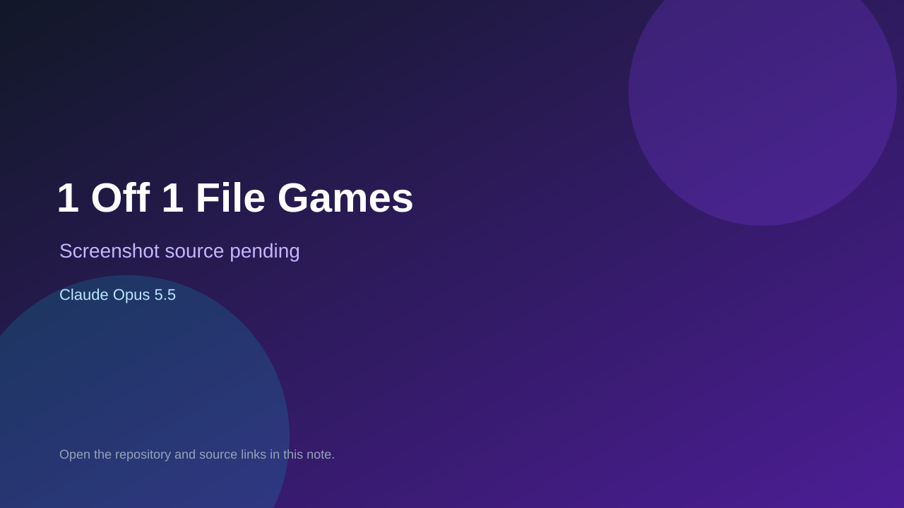

# 1 Off 1 File Games

> Top-list entry: **today** (#8).

## At a glance

- **Score:** 7.9/10
- **Model:** Claude Opus 5.5
- **Technology:** JavaScript, Browser
- **Estimated FP32 operations/s at 60 FPS:** 10,000,000 (low confidence; static estimate, not measured).
- **Rating basis:** Heuristic from source size, README and commit history (5.8 + 0.6*log10(code KB+1), +0.3 with a reachable demo); no runtime playtest.
- **Verified:** 2026-10-27
- **Repository:** [https://github.com/dougm1966/1off-1file-games](https://github.com/dougm1966/1off-1file-games)
- **Evidence:** [direct model evidence](https://github.com/dougm1966/1off-1file-games/commit/6fbbaac610f784c7e0ec25d46624f82c7ada154e)
- **Live demo:** [open demo](https://dougm1966.github.io/1off-1file-games/)
- **Additional live link:** [open demo](https://dougm1966.github.io/1off-1file-games/games/box-out/)
- **Additional live link:** [open demo](https://dougm1966.github.io/1off-1file-games/games/drop-four/)
- **Additional live link:** [open demo](https://dougm1966.github.io/1off-1file-games/games/eight-and-out/)

## Screenshots

No screenshot source is recorded yet. Keep the placeholder until a repository, awesome list, or creator source provides an image.

## Model attribution

Open the evidence link above. Evidence grade: **direct model evidence**.

## Source description

A collection of standalone, single-file games built with Claude. Each game is a self-contained experiment—easy to run, share, and play. Commit carries an exact Claude Opus 5.5 co-author trailer. Live demo returned HTTP 200 (availability only, not a playtest). Source inspected from README, file tree and commit history only; no playtest.

### Gameplay source

- [https://github.com/dougm1966/1off-1file-games/blob/main/games/under-the-scope/index.html](https://github.com/dougm1966/1off-1file-games/blob/main/games/under-the-scope/index.html)
- [https://github.com/dougm1966/1off-1file-games/commit/6fbbaac610f784c7e0ec25d46624f82c7ada154e](https://github.com/dougm1966/1off-1file-games/commit/6fbbaac610f784c7e0ec25d46624f82c7ada154e)

## Verification notes

- **Status:** verified_source
- **Counted units in repository:** 1
- **Units covered by this note:** 1
- **Discovery:** GitHub commit pool: model+game commits 2026-10-26T07:00Z..2026-10-27T01:00Z (30-minute Opus 5.5 and 2-6 hour other-model UTC partitions, via gh-read) joined to repositories created after 2026-10-25T01:00Z; https://github.com/dougm1966/1off-1file-games

[Back to the awesome list](../../README.md)
