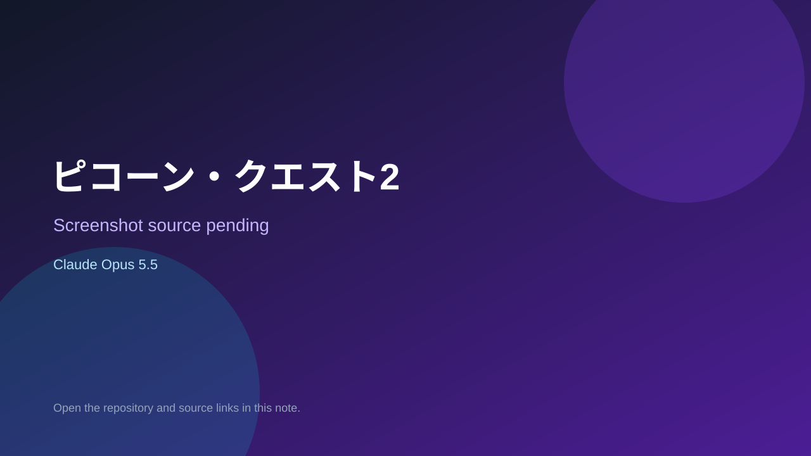

# ピコーン・クエスト2

> Top-list entry: **today** (#3), **this week** (#11), **this month** (#13).

## At a glance

- **Score:** 8.6/10
- **Model:** Claude Opus 5.5
- **Technology:** JavaScript, Browser
- **Estimated FP32 operations/s at 60 FPS:** 10,000,000 (low confidence; static estimate, not measured).
- **Rating basis:** Heuristic from source size, README and commit history (5.8 + 0.6*log10(code KB+1), +0.3 with a reachable demo); no runtime playtest.
- **Verified:** 2026-10-27
- **Repository:** [https://github.com/u1908inter/pikon-quest2](https://github.com/u1908inter/pikon-quest2)
- **Evidence:** [direct model evidence](https://github.com/u1908inter/pikon-quest2/commit/b55bfd0014c56be5dd40a247966edd39189aca65)
- **Live demo:** [open demo](https://u1908inter.github.io/pikon-quest2/)
- **Additional live link:** [open demo](https://u1908inter.github.io/pikon-quest2/pikon-quest2.html)

## Screenshots

No screenshot source is recorded yet. Keep the placeholder until a repository, awesome list, or creator source provides an image.

## Model attribution

Open the evidence link above. Evidence grade: **direct model evidence**.

## Source description

タップで連撃、戦いの中で技をひらめき、倒した敵を仲間にするドット絵のバトルRPG。. Commit carries an exact Claude Opus 5.5 co-author trailer. Live demo returned HTTP 200 (availability only, not a playtest). Source inspected from README, file tree and commit history only; no playtest.

### Gameplay source

- [https://github.com/u1908inter/pikon-quest2/blob/main/pikon-quest2.js](https://github.com/u1908inter/pikon-quest2/blob/main/pikon-quest2.js)
- [https://github.com/u1908inter/pikon-quest2/commit/b55bfd0014c56be5dd40a247966edd39189aca65](https://github.com/u1908inter/pikon-quest2/commit/b55bfd0014c56be5dd40a247966edd39189aca65)

## Verification notes

- **Status:** verified_source
- **Counted units in repository:** 1
- **Units covered by this note:** 1
- **Discovery:** GitHub commit pool: model+game commits 2026-10-26T07:00Z..2026-10-27T01:00Z (30-minute Opus 5.5 and 2-6 hour other-model UTC partitions, via gh-read) joined to repositories created after 2026-10-25T01:00Z; https://github.com/u1908inter/pikon-quest2

[Back to the awesome list](../../README.md)
