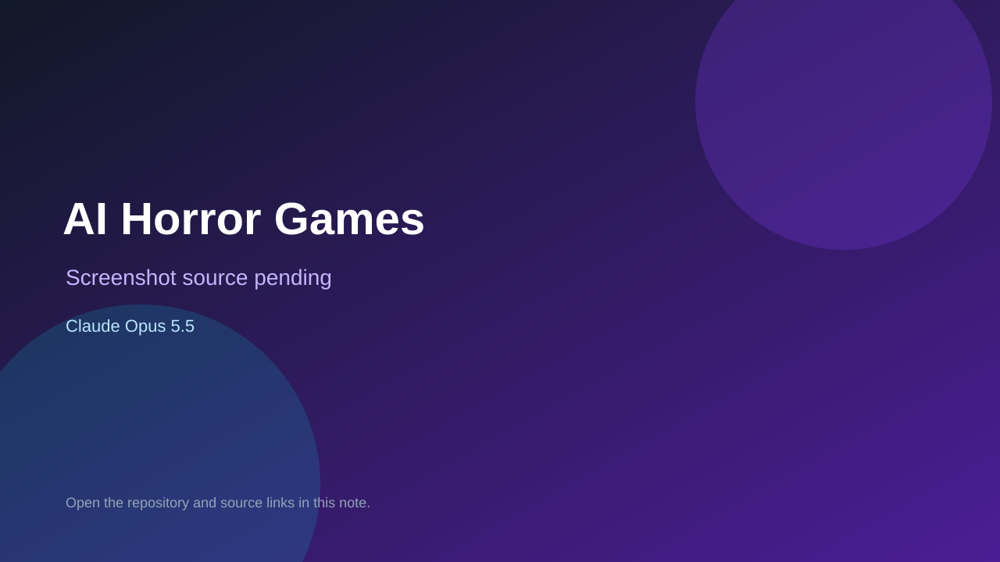

# AI Horror Games

> Top-list entry: **today** (#2), **this week** (#2), **this month** (#3).

## At a glance

- **Score:** 8.6/10
- **Model:** Claude Opus 5.5
- **Technology:** JavaScript, Three.js, Browser
- **Estimated FP32 operations/s at 60 FPS:** 1,000,000,000 (low confidence; static estimate, not measured).
- **Rating basis:** Heuristic from source size, README and commit history (5.8 + 0.6*log10(code KB+1), +0.3 with a reachable demo); no runtime playtest.
- **Verified:** 2026-10-26
- **Repository:** [https://github.com/KostiKoNeuro/ai-horror-games](https://github.com/KostiKoNeuro/ai-horror-games)
- **Evidence:** [direct model evidence](https://github.com/KostiKoNeuro/ai-horror-games/commit/5cb5257b6c5805dd994db9d24f841c7c1b97b14c)
- **Live demo:** [open demo](https://kostikoneuro.github.io/ai-horror-games/)
- **Additional live link:** [open demo](https://kostikoneuro.github.io/ai-horror-games/episode-1-scare-kostya/claude-opus-5.5/game/)
- **Additional live link:** [open demo](https://kostikoneuro.github.io/ai-horror-games/episode-1-scare-kostya/gemini-4-argon/game/)
- **Additional live link:** [open demo](https://kostikoneuro.github.io/ai-horror-games/episode-1-scare-kostya/kimi-k3.1-pro/)

## Screenshots

No screenshot source is recorded yet. Keep the placeholder until a repository, awesome list, or creator source provides an image.

## Model attribution

Open the evidence link above. Evidence grade: **direct model evidence**.

## Source description

Three AI models (Claude Opus 5.5, Gemini 4 Argon, Kimi K3.1) got $25 and 3 hours each to make a horror game that scares one person. Play them in your browser. Commit carries an exact Claude Opus 5.5 co-author trailer. Live demo returned HTTP 200 (availability only, not a playtest). Source inspected from README, file tree and commit history only; no playtest.

### Gameplay source

- [https://github.com/KostiKoNeuro/ai-horror-games/blob/main/episode-1-scare-kostya/claude-opus-5.5/game/audio.js](https://github.com/KostiKoNeuro/ai-horror-games/blob/main/episode-1-scare-kostya/claude-opus-5.5/game/audio.js)
- [https://github.com/KostiKoNeuro/ai-horror-games/commit/5cb5257b6c5805dd994db9d24f841c7c1b97b14c](https://github.com/KostiKoNeuro/ai-horror-games/commit/5cb5257b6c5805dd994db9d24f841c7c1b97b14c)

## Verification notes

- **Status:** verified_source
- **Counted units in repository:** 1
- **Units covered by this note:** 1
- **Discovery:** GitHub commit pool: model+game commits 2026-10-26T01:00Z..07:00Z (30-minute Opus 5.5 and 2-6 hour other-model UTC partitions, via gh-read) joined to repositories created after 2026-10-24T01:00Z; https://github.com/KostiKoNeuro/ai-horror-games

[Back to the awesome list](../../README.md)
