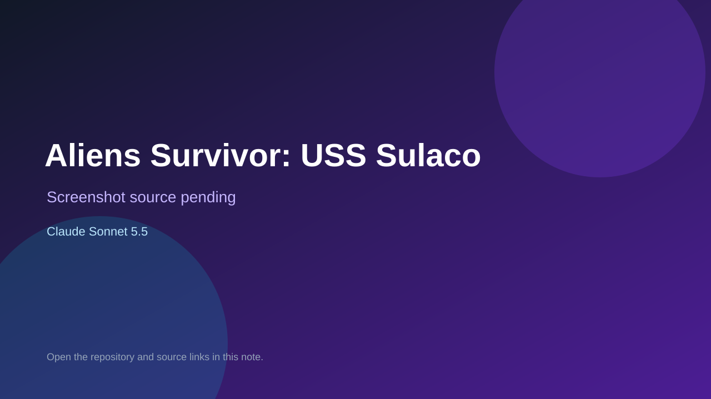

# Aliens Survivor: USS Sulaco

> Verified game note.

## At a glance

- **Score:** 7.7/10
- **Model:** Claude Sonnet 5.5
- **Technology:** TypeScript, Three.js, React, Browser, WebXR
- **Estimated FP32 operations/s at 60 FPS:** 1,000,000,000 (low confidence; static estimate, not measured).
- **Rating basis:** Heuristic from source size, README and commit history (5.8 + 0.6*log10(code KB+1), +0.3 with a reachable demo); no runtime playtest.
- **Verified:** 2026-10-26
- **Repository:** [https://github.com/steve-pritchard-83/aliens-survivor](https://github.com/steve-pritchard-83/aliens-survivor)
- **Evidence:** [direct model evidence](https://github.com/steve-pritchard-83/aliens-survivor/commit/cd96aeb9c631709db85b56b76959259d5259237b)
- **Live demo:** [open demo](https://aliens-survivor.vercel.app)

## Screenshots

No screenshot source is recorded yet. Keep the placeholder until a repository, awesome list, or creator source provides an image.

## Model attribution

Open the evidence link above. Evidence grade: **direct model evidence**.

## Source description

A 5-minute (300-second) first-person survival wave shooter set aboard the USS Sulaco, built with React 19, three.js, React Three Fiber, @react-three/xr and Zustand. Plays on Meta Quest 2/3 (WebXR), desktop web (WASD + pointer lock) and mobile (PWA with dual… Commit carries an exact Claude Sonnet 5.5 co-author trailer. Live demo returned HTTP 200 (availability only, not a playtest). Source inspected from README, file tree and commit history only; no playtest.

### Gameplay source

- [https://github.com/steve-pritchard-83/aliens-survivor/blob/main/e2e/vr.spec.ts](https://github.com/steve-pritchard-83/aliens-survivor/blob/main/e2e/vr.spec.ts)
- [https://github.com/steve-pritchard-83/aliens-survivor/commit/cd96aeb9c631709db85b56b76959259d5259237b](https://github.com/steve-pritchard-83/aliens-survivor/commit/cd96aeb9c631709db85b56b76959259d5259237b)

## Verification notes

- **Status:** verified_source
- **Counted units in repository:** 1
- **Units covered by this note:** 1
- **Discovery:** GitHub commit pool: model+game commits 2026-10-24T01:00Z..2026-10-26T01:00Z (30-minute Opus 5.5 partitions from 2026-10-24T20:00Z and wider other-model UTC partitions; covers windows left unsearched on 2026-10-25) joined to repositories created after 2026-10-23T01:00Z; https://github.com/steve-pritchard-83/aliens-survivor

[Back to the awesome list](../../README.md)
