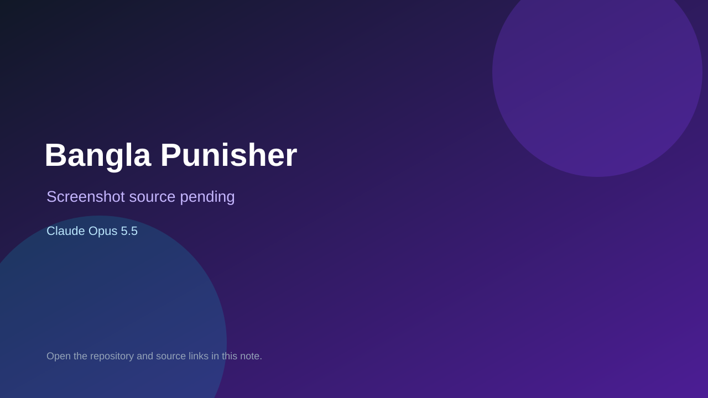

# Bangla Punisher

> Verified game note.

## At a glance

- **Score:** 7.2/10
- **Model:** Claude Opus 5.5
- **Technology:** JavaScript, Browser
- **Estimated FP32 operations/s at 60 FPS:** 10,000,000 (low confidence; static estimate, not measured).
- **Rating basis:** Heuristic from source size, README and commit history (5.8 + 0.6*log10(code KB+1), +0.3 with a reachable demo); no runtime playtest.
- **Verified:** 2026-10-27
- **Repository:** [https://github.com/neamulbd95/thePunisherGame](https://github.com/neamulbd95/thePunisherGame)
- **Evidence:** [direct model evidence](https://github.com/neamulbd95/thePunisherGame/commit/a3e031c19cfdd0f2a2b7514de378522b3df5d8bc)

## Screenshots

No screenshot source is recorded yet. Keep the placeholder until a repository, awesome list, or creator source provides an image.

## Model attribution

Open the evidence link above. Evidence grade: **direct model evidence**.

## Source description

A protest game against child abuse, street snatching and sexual violence in Bangladesh. Players punish a cartoon criminal by timing a swing on a shrinking, speeding-up dial. The game is a protest, not a substitute for justice: every game-over screen shows the… Commit carries an exact Claude Opus 5.5 co-author trailer. Source inspected from README, file tree and commit history only; no playtest.

### Gameplay source

- [https://github.com/neamulbd95/thePunisherGame/blob/main/frontend/js/render.js](https://github.com/neamulbd95/thePunisherGame/blob/main/frontend/js/render.js)
- [https://github.com/neamulbd95/thePunisherGame/commit/a3e031c19cfdd0f2a2b7514de378522b3df5d8bc](https://github.com/neamulbd95/thePunisherGame/commit/a3e031c19cfdd0f2a2b7514de378522b3df5d8bc)

## Verification notes

- **Status:** verified_source
- **Counted units in repository:** 1
- **Units covered by this note:** 1
- **Discovery:** GitHub commit pool: model+game commits 2026-10-26T07:00Z..2026-10-27T01:00Z (30-minute Opus 5.5 and 2-6 hour other-model UTC partitions, via gh-read) joined to repositories created after 2026-10-25T01:00Z; https://github.com/neamulbd95/thePunisherGame

[Back to the awesome list](../../README.md)
