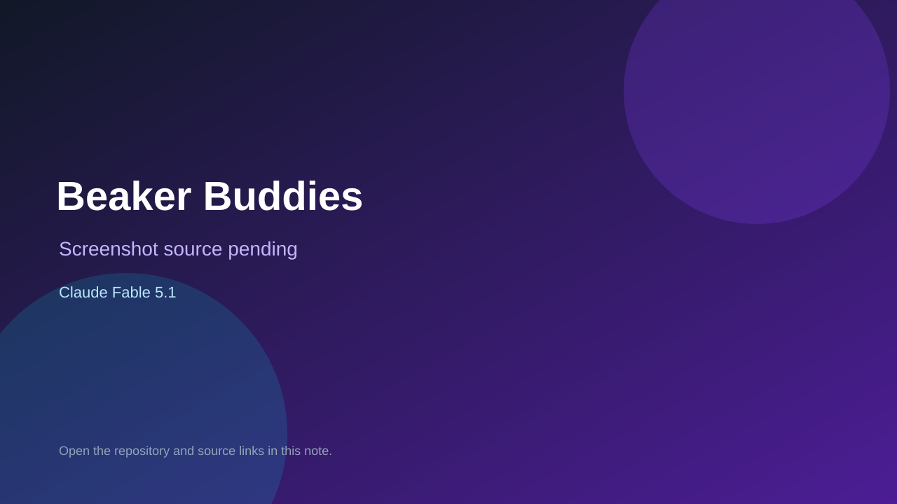

# Beaker Buddies

> Verified game note.

## At a glance

- **Score:** 7.3/10
- **Model:** Claude Fable 5.1
- **Technology:** TypeScript, Phaser, React, Browser
- **Estimated FP32 operations/s at 60 FPS:** 100,000,000 (low confidence; static estimate, not measured).
- **Rating basis:** Heuristic from source size, README and commit history (5.8 + 0.6*log10(code KB+1), +0.3 with a reachable demo); no runtime playtest.
- **Verified:** 2026-10-27
- **Repository:** [https://github.com/AviCagan/LetThemCook](https://github.com/AviCagan/LetThemCook)
- **Evidence:** [direct model evidence](https://github.com/AviCagan/LetThemCook/commit/a2d825ad95330d90f66965c13ec663689d3fa0ce)

## Screenshots

No screenshot source is recorded yet. Keep the placeholder until a repository, awesome list, or creator source provides an image.

## Model attribution

Open the evidence link above. Evidence grade: **direct model evidence**.

## Source description

A Game Boy Color-style lab game for drilling Organic Chemistry II reactions (Carey 12e, Ch 16–17). A customer walks into the lab with a molecule and asks for another one by IUPAC name (tap "?" to see the structure). You make it: pick a bottle from the shelf,… Commit carries an exact Claude Fable 5.1 co-author trailer. Source inspected from README, file tree and commit history only; no playtest.

### Gameplay source

- [https://github.com/AviCagan/LetThemCook/blob/ccr-1ea56b12-yyubol/src/art/sprites.ts](https://github.com/AviCagan/LetThemCook/blob/ccr-1ea56b12-yyubol/src/art/sprites.ts)
- [https://github.com/AviCagan/LetThemCook/commit/a2d825ad95330d90f66965c13ec663689d3fa0ce](https://github.com/AviCagan/LetThemCook/commit/a2d825ad95330d90f66965c13ec663689d3fa0ce)

## Verification notes

- **Status:** verified_source
- **Counted units in repository:** 1
- **Units covered by this note:** 1
- **Discovery:** GitHub commit pool: model+game commits 2026-10-26T07:00Z..2026-10-27T01:00Z (30-minute Opus 5.5 and 2-6 hour other-model UTC partitions, via gh-read) joined to repositories created after 2026-10-25T01:00Z; https://github.com/AviCagan/LetThemCook

[Back to the awesome list](../../README.md)
