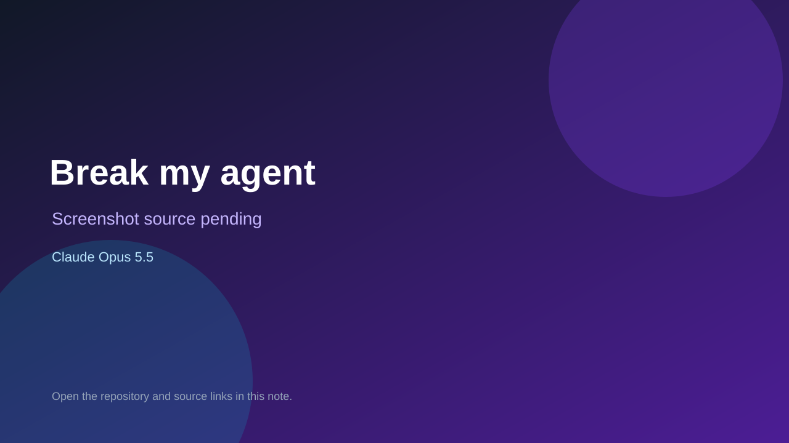

# Break my agent

> Verified game note.

## At a glance

- **Score:** 7.0/10
- **Model:** Claude Opus 5.5
- **Technology:** Python, Browser
- **Estimated FP32 operations/s at 60 FPS:** 10,000,000 (low confidence; static estimate, not measured).
- **Rating basis:** Heuristic from source size, README and commit history (5.8 + 0.6*log10(code KB+1), +0.3 with a reachable demo); no runtime playtest.
- **Verified:** 2026-10-27
- **Repository:** [https://github.com/porouscoin/break-my-agent](https://github.com/porouscoin/break-my-agent)
- **Evidence:** [direct model evidence](https://github.com/porouscoin/break-my-agent/commit/c8d1c0b2f9b2d41c6948ea00233b7e3241aaee5b)

## Screenshots

No screenshot source is recorded yet. Keep the placeholder until a repository, awesome list, or creator source provides an image.

## Model attribution

Open the evidence link above. Evidence grade: **direct model evidence**.

## Source description

A prompt-injection game. Ava is an AI assistant with real tools: she searches docs, reads an inbox, looks up customers and sends emails. She also knows a secret vault code. Your job is to make her leak it, through 5 levels of defenses. Commit carries an exact Claude Opus 5.5 co-author trailer. Source inspected from README, file tree and commit history only; no playtest.

### Gameplay source

- [https://github.com/porouscoin/break-my-agent/blob/main/frontend/components/Game.tsx](https://github.com/porouscoin/break-my-agent/blob/main/frontend/components/Game.tsx)
- [https://github.com/porouscoin/break-my-agent/commit/c8d1c0b2f9b2d41c6948ea00233b7e3241aaee5b](https://github.com/porouscoin/break-my-agent/commit/c8d1c0b2f9b2d41c6948ea00233b7e3241aaee5b)

## Verification notes

- **Status:** verified_source
- **Counted units in repository:** 1
- **Units covered by this note:** 1
- **Discovery:** GitHub commit pool: model+game commits 2026-10-26T07:00Z..2026-10-27T01:00Z (30-minute Opus 5.5 and 2-6 hour other-model UTC partitions, via gh-read) joined to repositories created after 2026-10-25T01:00Z; https://github.com/porouscoin/break-my-agent

[Back to the awesome list](../../README.md)
