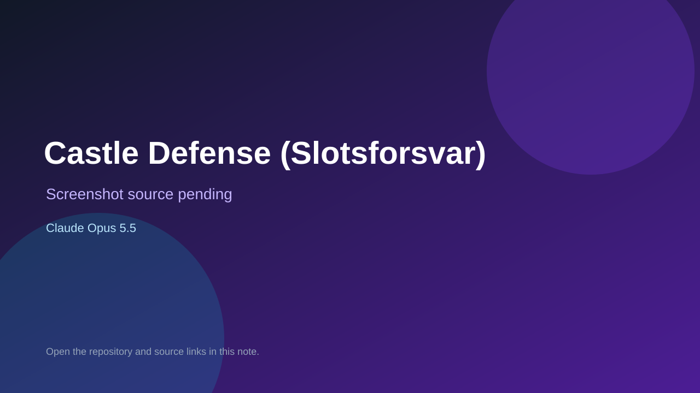

# Castle Defense (Slotsforsvar)

> Verified game note.

## At a glance

- **Score:** 7.3/10
- **Model:** Claude Opus 5.5
- **Technology:** JavaScript, Three.js, Browser
- **Estimated FP32 operations/s at 60 FPS:** 1,000,000,000 (low confidence; static estimate, not measured).
- **Rating basis:** Heuristic from source size, README and commit history (5.8 + 0.6*log10(code KB+1), +0.3 with a reachable demo); no runtime playtest.
- **Verified:** 2026-10-26
- **Repository:** [https://github.com/Lykhan28/slotsforsvar](https://github.com/Lykhan28/slotsforsvar)
- **Evidence:** [direct model evidence](https://github.com/Lykhan28/slotsforsvar/commit/49658af1e75c1eec2d557f45b23324f9fa2d6288)

## Screenshots

No screenshot source is recorded yet. Keep the placeholder until a repository, awesome list, or creator source provides an image.

## Model attribution

Open the evidence link above. Evidence grade: **direct model evidence**.

## Source description

A medieval 3D tower defense game for the browser. All the graphics and sound are drawn and generated in code (three.js + WebAudio), so the project contains no image or audio files. Commit carries an exact Claude Opus 5.5 co-author trailer. Source inspected from README, file tree and commit history only; no playtest.

### Gameplay source

- [https://github.com/Lykhan28/slotsforsvar/blob/main/archive/slotsforsvar-en-fil.html](https://github.com/Lykhan28/slotsforsvar/blob/main/archive/slotsforsvar-en-fil.html)
- [https://github.com/Lykhan28/slotsforsvar/commit/49658af1e75c1eec2d557f45b23324f9fa2d6288](https://github.com/Lykhan28/slotsforsvar/commit/49658af1e75c1eec2d557f45b23324f9fa2d6288)

## Verification notes

- **Status:** verified_source
- **Counted units in repository:** 1
- **Units covered by this note:** 1
- **Discovery:** GitHub commit pool: model+game commits 2026-10-26T01:00Z..07:00Z (30-minute Opus 5.5 and 2-6 hour other-model UTC partitions, via gh-read) joined to repositories created after 2026-10-24T01:00Z; https://github.com/Lykhan28/slotsforsvar

[Back to the awesome list](../../README.md)
