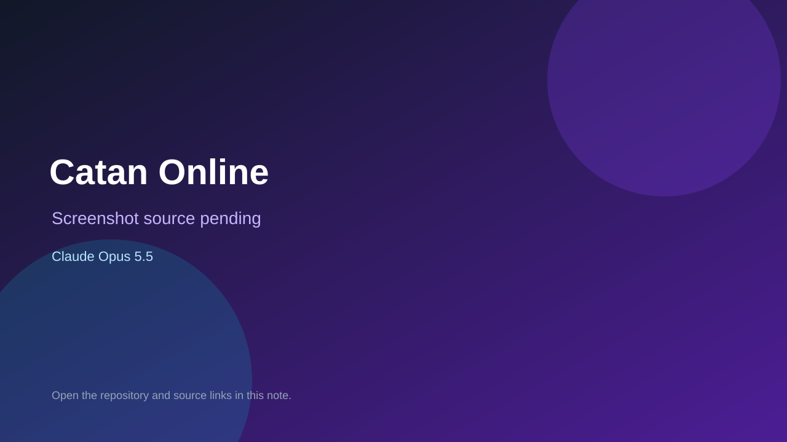

# Catan Online

> Verified game note.

## At a glance

- **Score:** 7.0/10
- **Model:** Claude Opus 5.5
- **Technology:** JavaScript, Browser
- **Estimated FP32 operations/s at 60 FPS:** 10,000,000 (low confidence; static estimate, not measured).
- **Rating basis:** Heuristic from source size, README and commit history (5.8 + 0.6*log10(code KB+1), +0.3 with a reachable demo); no runtime playtest.
- **Verified:** 2026-10-25
- **Repository:** [https://github.com/VarunS121/catan-online](https://github.com/VarunS121/catan-online)
- **Evidence:** [direct model evidence](https://github.com/VarunS121/catan-online/commit/06e51e7f08932497d6fd8285f9598e7918f24a61)

## Screenshots

No screenshot source is recorded yet. Keep the placeholder until a repository, awesome list, or creator source provides an image.

## Model attribution

Open the evidence link above. Evidence grade: **direct model evidence**.

## Source description

Private, real-time Catan for you and your friends in the browser. It supports the base game (2–4 players) and the 5–6 player extension, with no accounts. Commit carries an exact Claude Opus 5.5 co-author trailer. Source inspected from README, file tree and commit history only; no playtest.

### Gameplay source

- [https://github.com/VarunS121/catan-online/blob/main/public/app.js](https://github.com/VarunS121/catan-online/blob/main/public/app.js)
- [https://github.com/VarunS121/catan-online/commit/06e51e7f08932497d6fd8285f9598e7918f24a61](https://github.com/VarunS121/catan-online/commit/06e51e7f08932497d6fd8285f9598e7918f24a61)

## Verification notes

- **Status:** verified_source
- **Counted units in repository:** 1
- **Units covered by this note:** 1
- **Discovery:** GitHub commit pool: model+game commits 2026-10-24T01:00Z..2026-10-25T01:00Z (30-minute Opus 5.5 and wider other-model UTC partitions) joined to repositories created after 2026-10-23T01:00Z; https://github.com/VarunS121/catan-online

[Back to the awesome list](../../README.md)
