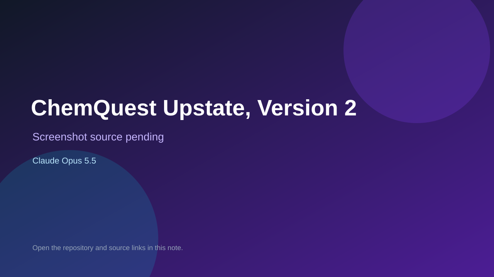

# ChemQuest Upstate, Version 2

> Top-list entry: **today** (#4).

## At a glance

- **Score:** 8.3/10
- **Model:** Claude Opus 5.5
- **Technology:** JavaScript, Browser
- **Estimated FP32 operations/s at 60 FPS:** 10,000,000 (low confidence; static estimate, not measured).
- **Rating basis:** Heuristic from source size, README and commit history (5.8 + 0.6*log10(code KB+1), +0.3 with a reachable demo); no runtime playtest.
- **Verified:** 2026-10-27
- **Repository:** [https://github.com/Kashee12345/chemquest-upstate-v2](https://github.com/Kashee12345/chemquest-upstate-v2)
- **Evidence:** [direct model evidence](https://github.com/Kashee12345/chemquest-upstate-v2/commit/a1e451ad2eab058ecb43dca21786414b8029dea2)
- **Live demo:** [open demo](https://kashee12345.github.io/chemquest-upstate-v2/)
- **Additional live link:** [open demo](https://kashee12345.github.io/chemquest-upstate/)

## Screenshots

No screenshot source is recorded yet. Keep the placeholder until a repository, awesome list, or creator source provides an image.

## Model attribution

Open the evidence link above. Evidence grade: **direct model evidence**.

## Source description

ChemQuest Upstate Version 2: a USC Upstate chemistrycareer game with verified Upstate SC career data. Commit carries an exact Claude Opus 5.5 co-author trailer. Live demo returned HTTP 200 (availability only, not a playtest). Source inspected from README, file tree and commit history only; no playtest.

### Gameplay source

- [https://github.com/Kashee12345/chemquest-upstate-v2/blob/main/index.html](https://github.com/Kashee12345/chemquest-upstate-v2/blob/main/index.html)
- [https://github.com/Kashee12345/chemquest-upstate-v2/commit/a1e451ad2eab058ecb43dca21786414b8029dea2](https://github.com/Kashee12345/chemquest-upstate-v2/commit/a1e451ad2eab058ecb43dca21786414b8029dea2)

## Verification notes

- **Status:** verified_source
- **Counted units in repository:** 1
- **Units covered by this note:** 1
- **Discovery:** GitHub commit pool: model+game commits 2026-10-26T07:00Z..2026-10-27T01:00Z (30-minute Opus 5.5 and 2-6 hour other-model UTC partitions, via gh-read) joined to repositories created after 2026-10-25T01:00Z; https://github.com/Kashee12345/chemquest-upstate-v2

[Back to the awesome list](../../README.md)
