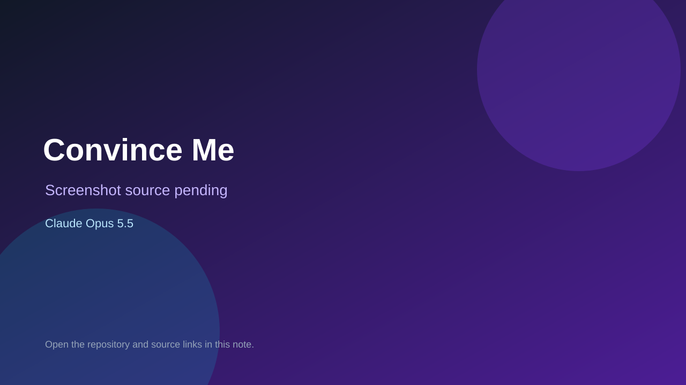

# Convince Me

> Verified game note.

## At a glance

- **Score:** 7.5/10
- **Model:** Claude Opus 5.5
- **Technology:** PHP
- **Estimated FP32 operations/s at 60 FPS:** 1,000,000 (low confidence; static estimate, not measured).
- **Rating basis:** Heuristic from source size, README and commit history (5.8 + 0.6*log10(code KB+1), +0.3 with a reachable demo); no runtime playtest.
- **Verified:** 2026-10-27
- **Repository:** [https://github.com/Vinzski/convince_me](https://github.com/Vinzski/convince_me)
- **Evidence:** [direct model evidence](https://github.com/Vinzski/convince_me/commit/9a878fa6bca34fa47c8f7a9a67e2335d2f0b82d3)

## Screenshots

No screenshot source is recorded yet. Keep the placeholder until a repository, awesome list, or creator source provides an image.

## Model attribution

Open the evidence link above. Evidence grade: **direct model evidence**.

## Source description

A browser game hub where you talk AI characters into things. Every game is single-player, takes a few minutes, and is played by typing: argue your case, calm a kidnapper, survive an interrogation, pitch a terrible product, sneak up to the CEO's office or pass… Commit carries an exact Claude Opus 5.5 co-author trailer. Source inspected from README, file tree and commit history only; no playtest.

### Gameplay source

- [https://github.com/Vinzski/convince_me/blob/main/app/Games/Objection/GameMaster.php](https://github.com/Vinzski/convince_me/blob/main/app/Games/Objection/GameMaster.php)
- [https://github.com/Vinzski/convince_me/commit/9a878fa6bca34fa47c8f7a9a67e2335d2f0b82d3](https://github.com/Vinzski/convince_me/commit/9a878fa6bca34fa47c8f7a9a67e2335d2f0b82d3)

## Verification notes

- **Status:** verified_source
- **Counted units in repository:** 1
- **Units covered by this note:** 1
- **Discovery:** GitHub commit pool: model+game commits 2026-10-26T07:00Z..2026-10-27T01:00Z (30-minute Opus 5.5 and 2-6 hour other-model UTC partitions, via gh-read) joined to repositories created after 2026-10-25T01:00Z; https://github.com/Vinzski/convince_me

[Back to the awesome list](../../README.md)
