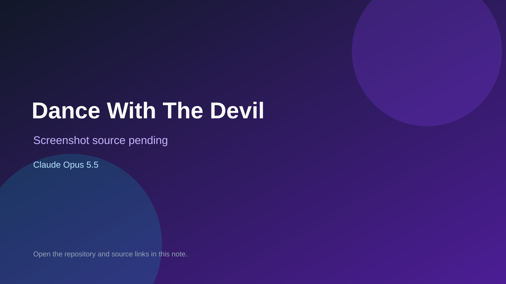

# Dance With The Devil

> Verified game note.

## At a glance

- **Score:** 7.6/10
- **Model:** Claude Opus 5.5
- **Technology:** Unity, C#
- **Estimated FP32 operations/s at 60 FPS:** 1,000,000,000 (low confidence; static estimate, not measured).
- **Rating basis:** Heuristic from source size, README and commit history (5.8 + 0.6*log10(code KB+1), +0.3 with a reachable demo); no runtime playtest.
- **Verified:** 2026-10-25
- **Repository:** [https://github.com/SefaSelim/dance-with-the-devil](https://github.com/SefaSelim/dance-with-the-devil)
- **Evidence:** [direct model evidence](https://github.com/SefaSelim/dance-with-the-devil/commit/9f7848db08fbb6c815fbb7c8692650e4589f5b82)

## Screenshots

No screenshot source is recorded yet. Keep the placeholder until a repository, awesome list, or creator source provides an image.

## Model attribution

Open the evidence link above. Evidence grade: **direct model evidence**.

## Source description

A game to participate in the Women Game Jam. Commit carries an exact Claude Opus 5.5 co-author trailer. Source inspected from README, file tree and commit history only; no playtest.

### Gameplay source

- [https://github.com/SefaSelim/dance-with-the-devil/blob/main/.claude/hooks/yaml-helper.sh](https://github.com/SefaSelim/dance-with-the-devil/blob/main/.claude/hooks/yaml-helper.sh)
- [https://github.com/SefaSelim/dance-with-the-devil/commit/9f7848db08fbb6c815fbb7c8692650e4589f5b82](https://github.com/SefaSelim/dance-with-the-devil/commit/9f7848db08fbb6c815fbb7c8692650e4589f5b82)

## Verification notes

- **Status:** verified_source
- **Counted units in repository:** 1
- **Units covered by this note:** 1
- **Discovery:** GitHub commit pool: model+game commits 2026-10-24T01:00Z..2026-10-25T01:00Z (30-minute Opus 5.5 and wider other-model UTC partitions) joined to repositories created after 2026-10-23T01:00Z; https://github.com/SefaSelim/dance-with-the-devil

[Back to the awesome list](../../README.md)
