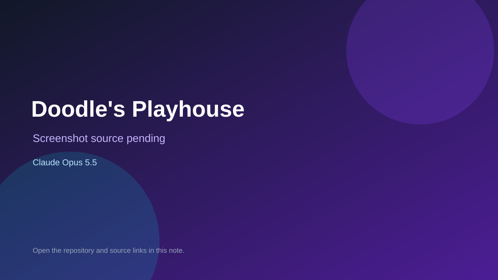

# Doodle's Playhouse

> Verified game note.

## At a glance

- **Score:** 7.3/10
- **Model:** Claude Opus 5.5
- **Technology:** JavaScript, Three.js, Browser
- **Estimated FP32 operations/s at 60 FPS:** 1,000,000,000 (low confidence; static estimate, not measured).
- **Rating basis:** Heuristic from source size, README and commit history (5.8 + 0.6*log10(code KB+1), +0.3 with a reachable demo); no runtime playtest.
- **Verified:** 2026-10-26
- **Repository:** [https://github.com/alceledon/doodles-playhouse](https://github.com/alceledon/doodles-playhouse)
- **Evidence:** [direct model evidence](https://github.com/alceledon/doodles-playhouse/commit/f455117580479df2173b593d2c153dcf34a5e441)
- **Live demo:** [open demo](https://alceledon.github.io/doodles-playhouse/)

## Screenshots

No screenshot source is recorded yet. Keep the placeholder until a repository, awesome list, or creator source provides an image.

## Model attribution

Open the evidence link above. Evidence grade: **direct model evidence**.

## Source description

A Granny-style first-person horror game in the browser: escape the playhouse before Doodle the golden doodle catches you. Commit carries an exact Claude Opus 5.5 co-author trailer. Live demo returned HTTP 200 (availability only, not a playtest). Source inspected from README, file tree and commit history only; no playtest.

### Gameplay source

- [https://github.com/alceledon/doodles-playhouse/blob/main/src/core/contracts.js](https://github.com/alceledon/doodles-playhouse/blob/main/src/core/contracts.js)
- [https://github.com/alceledon/doodles-playhouse/commit/f455117580479df2173b593d2c153dcf34a5e441](https://github.com/alceledon/doodles-playhouse/commit/f455117580479df2173b593d2c153dcf34a5e441)

## Verification notes

- **Status:** verified_source
- **Counted units in repository:** 1
- **Units covered by this note:** 1
- **Discovery:** GitHub commit pool: model+game commits 2026-10-26T01:00Z..07:00Z (30-minute Opus 5.5 and 2-6 hour other-model UTC partitions, via gh-read) joined to repositories created after 2026-10-24T01:00Z; https://github.com/alceledon/doodles-playhouse

[Back to the awesome list](../../README.md)
