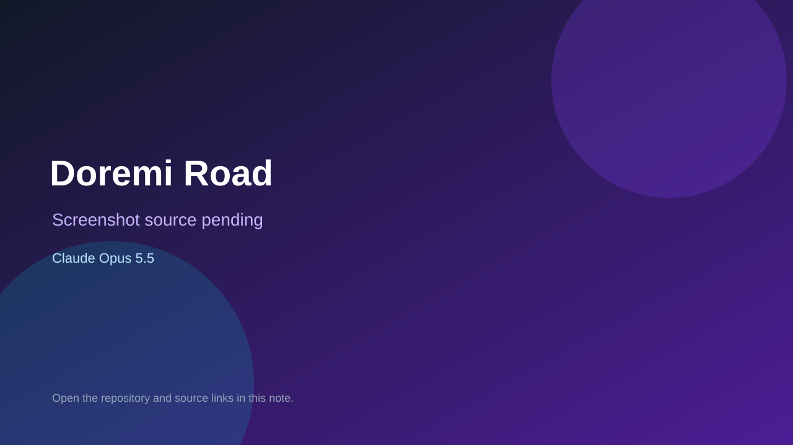

# Doremi Road

> Verified game note.

## At a glance

- **Score:** 7.4/10
- **Model:** Claude Opus 5.5
- **Technology:** Python
- **Estimated FP32 operations/s at 60 FPS:** 1,000,000 (low confidence; static estimate, not measured).
- **Rating basis:** Heuristic from source size, README and commit history (5.8 + 0.6*log10(code KB+1), +0.3 with a reachable demo); no runtime playtest.
- **Verified:** 2026-10-26
- **Repository:** [https://github.com/arkulinskis/doremiroad](https://github.com/arkulinskis/doremiroad)
- **Evidence:** [direct model evidence](https://github.com/arkulinskis/doremiroad/commit/cdc2b8fe6e13aef16a5dc146ad37ee0e5746d0aa)
- **Live demo:** [open demo](https://anvil.works/build/apps/ECVHEZIZ7CUWZAUS)

## Screenshots

No screenshot source is recorded yet. Keep the placeholder until a repository, awesome list, or creator source provides an image.

## Model attribution

Open the evidence link above. Evidence grade: **direct model evidence**.

## Source description

A piano-learning game for anvil.works. You travel a road across the Realm of Harmony, a map of musical knowledge. Each territory teaches one part of music; every level you clear claims one of its provinces in your banner colour, and clearing them all conquers… Commit carries an exact Claude Opus 5.5 co-author trailer. Live demo returned HTTP 200 (availability only, not a playtest). Source inspected from README, file tree and commit history only; no playtest.

### Gameplay source

- [https://github.com/arkulinskis/doremiroad/blob/master/server_code/Levels.py](https://github.com/arkulinskis/doremiroad/blob/master/server_code/Levels.py)
- [https://github.com/arkulinskis/doremiroad/commit/cdc2b8fe6e13aef16a5dc146ad37ee0e5746d0aa](https://github.com/arkulinskis/doremiroad/commit/cdc2b8fe6e13aef16a5dc146ad37ee0e5746d0aa)

## Verification notes

- **Status:** verified_source
- **Counted units in repository:** 1
- **Units covered by this note:** 1
- **Discovery:** GitHub commit pool: model+game commits 2026-10-26T01:00Z..07:00Z (30-minute Opus 5.5 and 2-6 hour other-model UTC partitions, via gh-read) joined to repositories created after 2026-10-24T01:00Z; https://github.com/arkulinskis/doremiroad

[Back to the awesome list](../../README.md)
