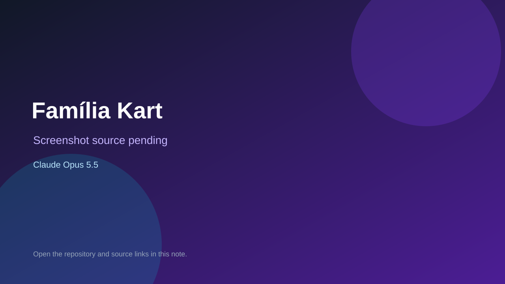

# Família Kart

> Verified game note.

## At a glance

- **Score:** 7.3/10
- **Model:** Claude Opus 5.5
- **Technology:** JavaScript, Browser
- **Estimated FP32 operations/s at 60 FPS:** 100,000,000 (low confidence; static estimate, not measured).
- **Rating basis:** Heuristic from source size, README and commit history (5.8 + 0.6*log10(code KB+1), +0.3 with a reachable demo); no runtime playtest.
- **Verified:** 2026-10-27
- **Repository:** [https://github.com/guilherme-reis-ia/kart-mariana-henrique-elena](https://github.com/guilherme-reis-ia/kart-mariana-henrique-elena)
- **Evidence:** [direct model evidence](https://github.com/guilherme-reis-ia/kart-mariana-henrique-elena/commit/c3d204e0c7a6a57876c11fde1b4193e83102d631)
- **Live demo:** [open demo](https://guilherme-reis-ia.github.io/kart-mariana-henrique-elena/)

## Screenshots

No screenshot source is recorded yet. Keep the placeholder until a repository, awesome list, or creator source provides an image.

## Model attribution

Open the evidence link above. Evidence grade: **direct model evidence**.

## Source description

Jogo de kart 2D top-down em HTML5 + JavaScript puro + Canvas. Commit carries an exact Claude Opus 5.5 co-author trailer. Live demo returned HTTP 200 (availability only, not a playtest). Source inspected from README, file tree and commit history only; no playtest.

### Gameplay source

- [https://github.com/guilherme-reis-ia/kart-mariana-henrique-elena/blob/main/js/corrida.js](https://github.com/guilherme-reis-ia/kart-mariana-henrique-elena/blob/main/js/corrida.js)
- [https://github.com/guilherme-reis-ia/kart-mariana-henrique-elena/commit/c3d204e0c7a6a57876c11fde1b4193e83102d631](https://github.com/guilherme-reis-ia/kart-mariana-henrique-elena/commit/c3d204e0c7a6a57876c11fde1b4193e83102d631)

## Verification notes

- **Status:** verified_source
- **Counted units in repository:** 1
- **Units covered by this note:** 1
- **Discovery:** GitHub commit pool: model+game commits 2026-10-26T07:00Z..2026-10-27T01:00Z (30-minute Opus 5.5 and 2-6 hour other-model UTC partitions, via gh-read) joined to repositories created after 2026-10-25T01:00Z; https://github.com/guilherme-reis-ia/kart-mariana-henrique-elena

[Back to the awesome list](../../README.md)
