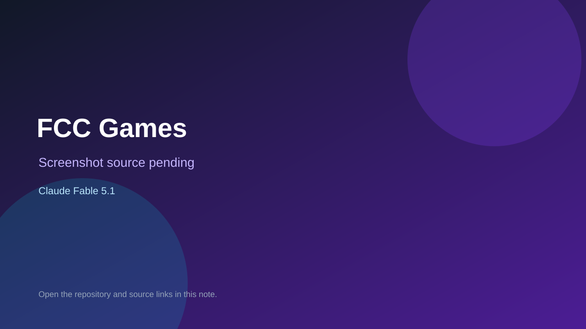

# FCC Games

> Verified game note.

## At a glance

- **Score:** 7.4/10
- **Model:** Claude Fable 5.1
- **Technology:** JavaScript, Browser
- **Estimated FP32 operations/s at 60 FPS:** 10,000,000 (low confidence; static estimate, not measured).
- **Rating basis:** Heuristic from source size, README and commit history (5.8 + 0.6*log10(code KB+1), +0.3 with a reachable demo); no runtime playtest.
- **Verified:** 2026-10-27
- **Repository:** [https://github.com/amossteven/FCCgames](https://github.com/amossteven/FCCgames)
- **Evidence:** [direct model evidence](https://github.com/amossteven/FCCgames/commit/fb29065efd37a7f560b7f4f45c1031545a97e0ef)
- **Live demo:** [open demo](https://amossteven.github.io/FCCgames/)
- **Additional live link:** [open demo](https://amossteven.github.io/FCCgames/games/telly-trumps.html#eyJwIjpbIlN0ZXZlIi)

## Screenshots

No screenshot source is recorded yet. Keep the placeholder until a repository, awesome list, or creator source provides an image.

## Model attribution

Open the evidence link above. Evidence grade: **direct model evidence**.

## Source description

Turn-by-turn games themed around UK film and television, built to be played inside a chat or messaging area. No server, no accounts, no database: each game is a single HTML page and the entire game state lives in the link. Commit carries an exact Claude Fable 5.1 co-author trailer. Live demo returned HTTP 200 (availability only, not a playtest). Source inspected from README, file tree and commit history only; no playtest.

### Gameplay source

- [https://github.com/amossteven/FCCgames/blob/main/mock/chat.html](https://github.com/amossteven/FCCgames/blob/main/mock/chat.html)
- [https://github.com/amossteven/FCCgames/commit/fb29065efd37a7f560b7f4f45c1031545a97e0ef](https://github.com/amossteven/FCCgames/commit/fb29065efd37a7f560b7f4f45c1031545a97e0ef)

## Verification notes

- **Status:** verified_source
- **Counted units in repository:** 1
- **Units covered by this note:** 1
- **Discovery:** GitHub commit pool: model+game commits 2026-10-26T07:00Z..2026-10-27T01:00Z (30-minute Opus 5.5 and 2-6 hour other-model UTC partitions, via gh-read) joined to repositories created after 2026-10-25T01:00Z; https://github.com/amossteven/FCCgames

[Back to the awesome list](../../README.md)
