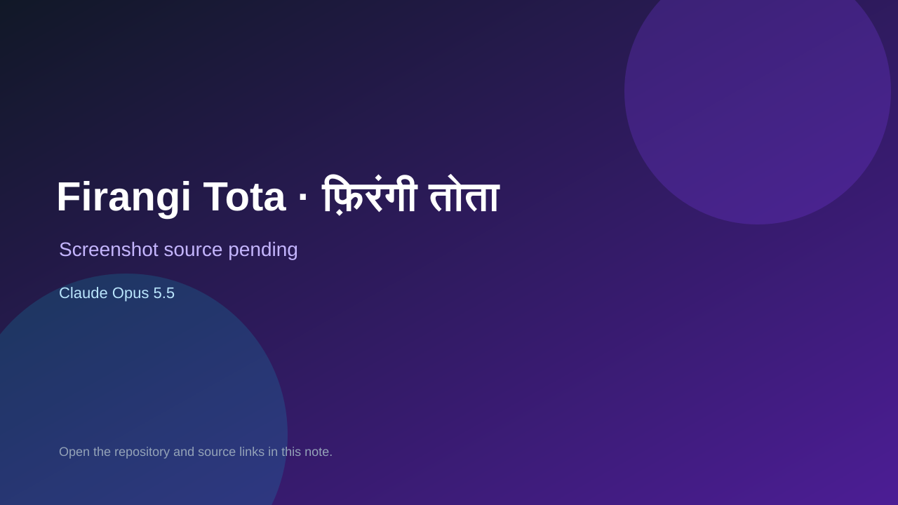

# Firangi Tota · फ़िरंगी तोता

> Top-list entry: **today** (#10).

## At a glance

- **Score:** 8.1/10
- **Model:** Claude Opus 5.5
- **Technology:** TypeScript, Browser
- **Estimated FP32 operations/s at 60 FPS:** 1,000,000,000 (low confidence; static estimate, not measured).
- **Rating basis:** Heuristic from source size, README and commit history (5.8 + 0.6*log10(code KB+1), +0.3 with a reachable demo); no runtime playtest.
- **Verified:** 2026-10-25
- **Repository:** [https://github.com/urmaliyadivyanshu31/firangi-tota](https://github.com/urmaliyadivyanshu31/firangi-tota)
- **Evidence:** [direct model evidence](https://github.com/urmaliyadivyanshu31/firangi-tota/commit/d2ce6fa68af226be0adfe3ecc6a605c4fed6530f)
- **Live demo:** [open demo](https://firangitota.com)

## Screenshots

No screenshot source is recorded yet. Keep the placeholder until a repository, awesome list, or creator source provides an image.

## Model attribution

Open the evidence link above. Evidence grade: **direct model evidence**.

## Source description

Firangi Tota · फ़िरंगी तोता — a browser game: spot the British forger's fake messages in 1857, 1929, 1942 and 1947. English + Hindi. Every fact sourced. Commit carries an exact Claude Opus 5.5 co-author trailer. Live demo returned HTTP 200 (availability only, not a playtest). Source inspected from README, file tree and commit history only; no playtest.

### Gameplay source

- [https://github.com/urmaliyadivyanshu31/firangi-tota/blob/main/src/content/eras/delhi-1947/messages.ts](https://github.com/urmaliyadivyanshu31/firangi-tota/blob/main/src/content/eras/delhi-1947/messages.ts)
- [https://github.com/urmaliyadivyanshu31/firangi-tota/commit/d2ce6fa68af226be0adfe3ecc6a605c4fed6530f](https://github.com/urmaliyadivyanshu31/firangi-tota/commit/d2ce6fa68af226be0adfe3ecc6a605c4fed6530f)

## Verification notes

- **Status:** verified_source
- **Counted units in repository:** 1
- **Units covered by this note:** 1
- **Discovery:** GitHub commit pool: model+game commits 2026-10-24T01:00Z..2026-10-25T01:00Z (30-minute Opus 5.5 and wider other-model UTC partitions) joined to repositories created after 2026-10-23T01:00Z; https://github.com/urmaliyadivyanshu31/firangi-tota

[Back to the awesome list](../../README.md)
