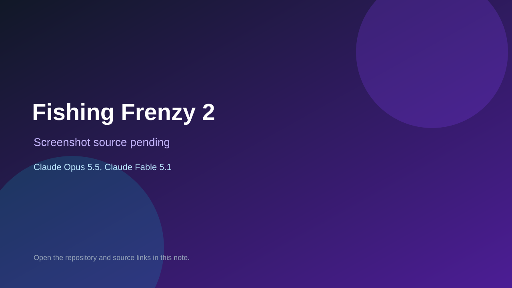

# Fishing Frenzy 2

> Top-list entry: **today** (#9).

## At a glance

- **Score:** 8.1/10
- **Model:** Claude Opus 5.5, Claude Fable 5.1
- **Technology:** JavaScript, Browser
- **Estimated FP32 operations/s at 60 FPS:** 10,000,000 (low confidence; static estimate, not measured).
- **Rating basis:** Heuristic from source size, README and commit history (5.8 + 0.6*log10(code KB+1), +0.3 with a reachable demo); no runtime playtest.
- **Verified:** 2026-10-25
- **Repository:** [https://github.com/tarun-figmaboy-838/fishing-frenzy-2](https://github.com/tarun-figmaboy-838/fishing-frenzy-2)
- **Evidence:** [direct model evidence](https://github.com/tarun-figmaboy-838/fishing-frenzy-2/commit/e457159d69a5e4945c4eeb7c7aa313d7fa6e7731)
- **Live demo:** [open demo](https://fishing-frenzy-2-t6d6.vercel.app)

## Screenshots

No screenshot source is recorded yet. Keep the placeholder until a repository, awesome list, or creator source provides an image.

## Model attribution

Open the evidence link above. Evidence grade: **direct model evidence**.

## Source description

A voiced maths adventure about parallelograms: part 2 of Fishing Frenzy, played the way part 1 is, as one journey. Commit carries an exact Claude Opus 5.5 / Claude Fable 5.1 co-author trailer. Live demo returned HTTP 200 (availability only, not a playtest). Source inspected from README, file tree and commit history only; no playtest.

### Gameplay source

- [https://github.com/tarun-figmaboy-838/fishing-frenzy-2/blob/main/parts/fishing/src/voice-data.js](https://github.com/tarun-figmaboy-838/fishing-frenzy-2/blob/main/parts/fishing/src/voice-data.js)
- [https://github.com/tarun-figmaboy-838/fishing-frenzy-2/commit/e457159d69a5e4945c4eeb7c7aa313d7fa6e7731](https://github.com/tarun-figmaboy-838/fishing-frenzy-2/commit/e457159d69a5e4945c4eeb7c7aa313d7fa6e7731)

## Verification notes

- **Status:** verified_source
- **Counted units in repository:** 1
- **Units covered by this note:** 1
- **Discovery:** GitHub commit pool: model+game commits 2026-10-23T01:00Z..2026-10-24T01:00Z (30-minute Opus 5.5 and wider other-model UTC partitions) joined to repositories created after 2026-10-22T01:00Z; carried over from the 2026-10-24 pending list; https://github.com/tarun-figmaboy-838/fishing-frenzy-2

[Back to the awesome list](../../README.md)
