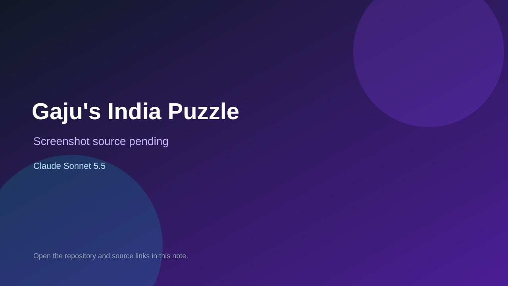

# Gaju's India Puzzle

> Verified game note.

## At a glance

- **Score:** 7.6/10
- **Model:** Claude Sonnet 5.5
- **Technology:** JavaScript, Browser
- **Estimated FP32 operations/s at 60 FPS:** 10,000,000 (low confidence; static estimate, not measured).
- **Rating basis:** Heuristic from source size, README and commit history (5.8 + 0.6*log10(code KB+1), +0.3 with a reachable demo); no runtime playtest.
- **Verified:** 2026-10-27
- **Repository:** [https://github.com/hema-g01/GajusIndiaPuzzle](https://github.com/hema-g01/GajusIndiaPuzzle)
- **Evidence:** [direct model evidence](https://github.com/hema-g01/GajusIndiaPuzzle/commit/df8ec9b1748f492c66e8591677fcfa47a0f4d221)

## Screenshots

No screenshot source is recorded yet. Keep the placeholder until a repository, awesome list, or creator source provides an image.

## Model attribution

Open the evidence link above. Evidence grade: **direct model evidence**.

## Source description

A map puzzle game for children. Drag states, districts, continents and countries onto the map, answer a few questions, and learn with Gaju the elephant. It is plain HTML, CSS and JavaScript (ES modules): no build step, no dependencies. Commit carries an exact Claude Sonnet 5.5 co-author trailer. Source inspected from README, file tree and commit history only; no playtest.

### Gameplay source

- [https://github.com/hema-g01/GajusIndiaPuzzle/blob/main/legacy/gajus-india-puzzle.original.html](https://github.com/hema-g01/GajusIndiaPuzzle/blob/main/legacy/gajus-india-puzzle.original.html)
- [https://github.com/hema-g01/GajusIndiaPuzzle/commit/df8ec9b1748f492c66e8591677fcfa47a0f4d221](https://github.com/hema-g01/GajusIndiaPuzzle/commit/df8ec9b1748f492c66e8591677fcfa47a0f4d221)

## Verification notes

- **Status:** verified_source
- **Counted units in repository:** 1
- **Units covered by this note:** 1
- **Discovery:** GitHub commit pool: model+game commits 2026-10-26T07:00Z..2026-10-27T01:00Z (30-minute Opus 5.5 and 2-6 hour other-model UTC partitions, via gh-read) joined to repositories created after 2026-10-25T01:00Z; https://github.com/hema-g01/GajusIndiaPuzzle

[Back to the awesome list](../../README.md)
