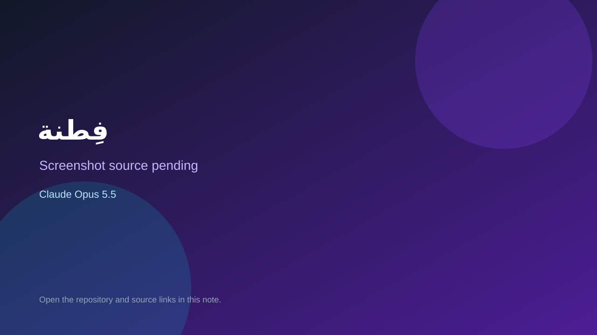

# فِطنة

> Verified game note.

## At a glance

- **Score:** 7.4/10
- **Model:** Claude Opus 5.5
- **Technology:** Swift
- **Estimated FP32 operations/s at 60 FPS:** 1,000,000 (low confidence; static estimate, not measured).
- **Rating basis:** Heuristic from source size, README and commit history (5.8 + 0.6*log10(code KB+1), +0.3 with a reachable demo); no runtime playtest.
- **Verified:** 2026-10-26
- **Repository:** [https://github.com/almoussaabdullah/Fitna](https://github.com/almoussaabdullah/Fitna)
- **Evidence:** [direct model evidence](https://github.com/almoussaabdullah/Fitna/commit/6741af9579017b677f98f96c87b1ef7c54ef5ba7)

## Screenshots

No screenshot source is recorded yet. Keep the placeholder until a repository, awesome list, or creator source provides an image.

## Model attribution

Open the evidence link above. Evidence grade: **direct model evidence**.

## Source description

فطنة - Arabic brain-training game for iOS. Commit carries an exact Claude Opus 5.5 co-author trailer. Source inspected from README, file tree and commit history only; no playtest.

### Gameplay source

- [https://github.com/almoussaabdullah/Fitna/blob/main/tools/strings_ar.py](https://github.com/almoussaabdullah/Fitna/blob/main/tools/strings_ar.py)
- [https://github.com/almoussaabdullah/Fitna/commit/6741af9579017b677f98f96c87b1ef7c54ef5ba7](https://github.com/almoussaabdullah/Fitna/commit/6741af9579017b677f98f96c87b1ef7c54ef5ba7)

## Verification notes

- **Status:** verified_source
- **Counted units in repository:** 1
- **Units covered by this note:** 1
- **Discovery:** GitHub commit pool: model+game commits 2026-10-24T01:00Z..2026-10-26T01:00Z (30-minute Opus 5.5 partitions from 2026-10-24T20:00Z and wider other-model UTC partitions; covers windows left unsearched on 2026-10-25) joined to repositories created after 2026-10-23T01:00Z; https://github.com/almoussaabdullah/Fitna

[Back to the awesome list](../../README.md)
