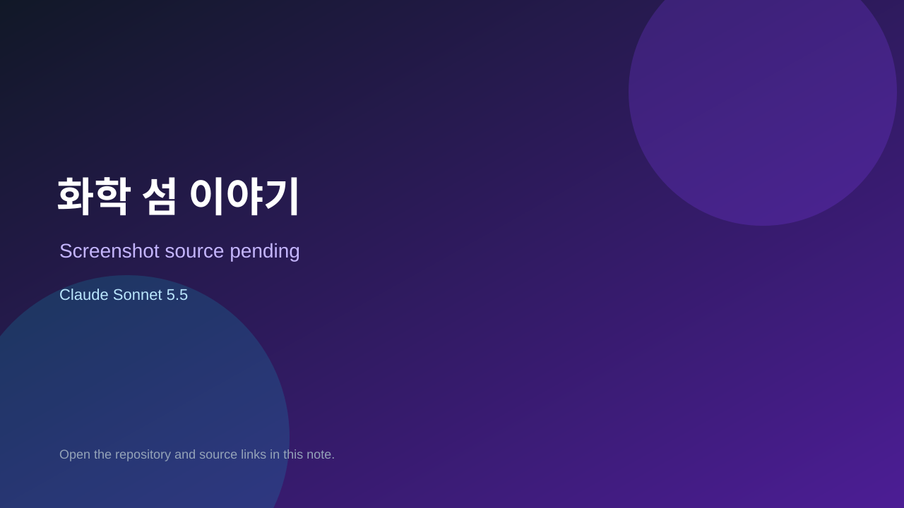

# 화학 섬 이야기

> Verified game note.

## At a glance

- **Score:** 7.0/10
- **Model:** Claude Sonnet 5.5
- **Technology:** JavaScript, Browser
- **Estimated FP32 operations/s at 60 FPS:** 10,000,000 (low confidence; static estimate, not measured).
- **Rating basis:** Heuristic from source size, README and commit history (5.8 + 0.6*log10(code KB+1), +0.3 with a reachable demo); no runtime playtest.
- **Verified:** 2026-10-26
- **Repository:** [https://github.com/bldoijoa01-lab/chem-island](https://github.com/bldoijoa01-lab/chem-island)
- **Evidence:** [direct model evidence](https://github.com/bldoijoa01-lab/chem-island/commit/d4dbe4743c08d70ee04cda47f798ef8a10c83e81)

## Screenshots

No screenshot source is recorded yet. Keep the placeholder until a repository, awesome list, or creator source provides an image.

## Model attribution

Open the evidence link above. Evidence grade: **direct model evidence**.

## Source description

바닷물을 증류하고, 압력 밥솥으로 라면을 끓이고, 소금 얼음으로 한제를 만들고, 공기를 모아 솥 골렘을 정화하는 화학 기지 건설 게임. Commit carries an exact Claude Sonnet 5.5 co-author trailer. Source inspected from README, file tree and commit history only; no playtest.

### Gameplay source

- [https://github.com/bldoijoa01-lab/chem-island/blob/main/game.js](https://github.com/bldoijoa01-lab/chem-island/blob/main/game.js)
- [https://github.com/bldoijoa01-lab/chem-island/commit/d4dbe4743c08d70ee04cda47f798ef8a10c83e81](https://github.com/bldoijoa01-lab/chem-island/commit/d4dbe4743c08d70ee04cda47f798ef8a10c83e81)

## Verification notes

- **Status:** verified_source
- **Counted units in repository:** 1
- **Units covered by this note:** 1
- **Discovery:** GitHub commit pool: model+game commits 2026-10-24T01:00Z..2026-10-26T01:00Z (30-minute Opus 5.5 partitions from 2026-10-24T20:00Z and wider other-model UTC partitions; covers windows left unsearched on 2026-10-25) joined to repositories created after 2026-10-23T01:00Z; https://github.com/bldoijoa01-lab/chem-island

[Back to the awesome list](../../README.md)
