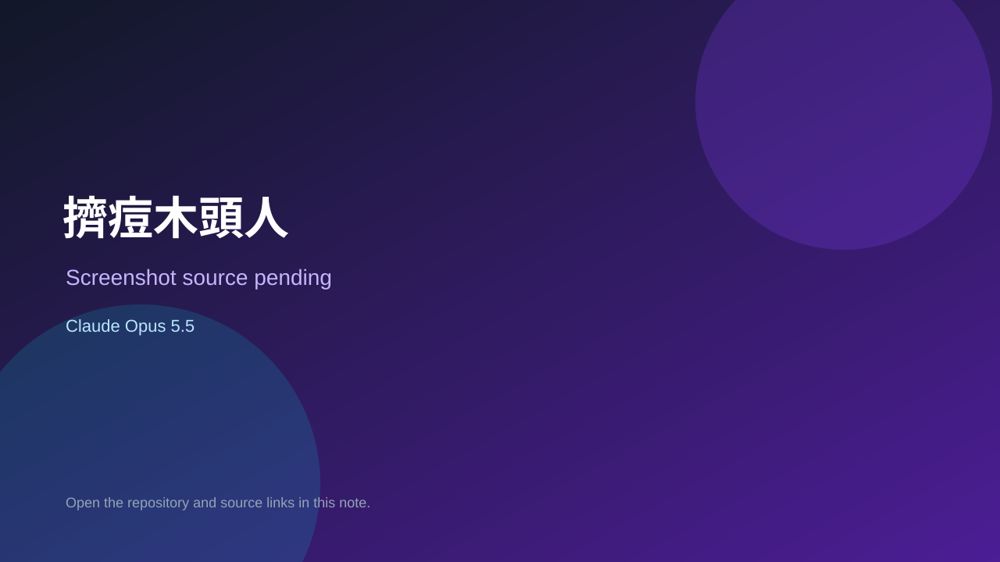

# 擠痘木頭人

> Verified game note.

## At a glance

- **Score:** 7.0/10
- **Model:** Claude Opus 5.5
- **Technology:** JavaScript, Browser
- **Estimated FP32 operations/s at 60 FPS:** 100,000,000 (low confidence; static estimate, not measured).
- **Rating basis:** Heuristic from source size, README and commit history (5.8 + 0.6*log10(code KB+1), +0.3 with a reachable demo); no runtime playtest.
- **Verified:** 2026-10-26
- **Repository:** [https://github.com/eugenia9797/Acne_game](https://github.com/eugenia9797/Acne_game)
- **Evidence:** [direct model evidence](https://github.com/eugenia9797/Acne_game/commit/9445b30d5be0d1c4b3266ee4e7f727cb15a1b3ed)

## Screenshots

No screenshot source is recorded yet. Keep the placeholder until a repository, awesome list, or creator source provides an image.

## Model attribution

Open the evidence link above. Evidence grade: **direct model evidence**.

## Source description

一二三木頭人玩法的擠痘痘網頁小遊戲。你是滿臉痘痘的病人，趁皮膚科醫師背對你打病歷時偷偷擠痘痘。醫師跟著音樂唸「被我抓到你在擠痘痘你就完蛋了」，音樂一唱完她就回頭，手還在臉上就出局。. Commit carries an exact Claude Opus 5.5 co-author trailer. Source inspected from README, file tree and commit history only; no playtest.

### Gameplay source

- [https://github.com/eugenia9797/Acne_game/blob/main/index.html](https://github.com/eugenia9797/Acne_game/blob/main/index.html)
- [https://github.com/eugenia9797/Acne_game/commit/9445b30d5be0d1c4b3266ee4e7f727cb15a1b3ed](https://github.com/eugenia9797/Acne_game/commit/9445b30d5be0d1c4b3266ee4e7f727cb15a1b3ed)

## Verification notes

- **Status:** verified_source
- **Counted units in repository:** 1
- **Units covered by this note:** 1
- **Discovery:** GitHub commit pool: model+game commits 2026-10-24T01:00Z..2026-10-26T01:00Z (30-minute Opus 5.5 partitions from 2026-10-24T20:00Z and wider other-model UTC partitions; covers windows left unsearched on 2026-10-25) joined to repositories created after 2026-10-23T01:00Z; https://github.com/eugenia9797/Acne_game

[Back to the awesome list](../../README.md)
