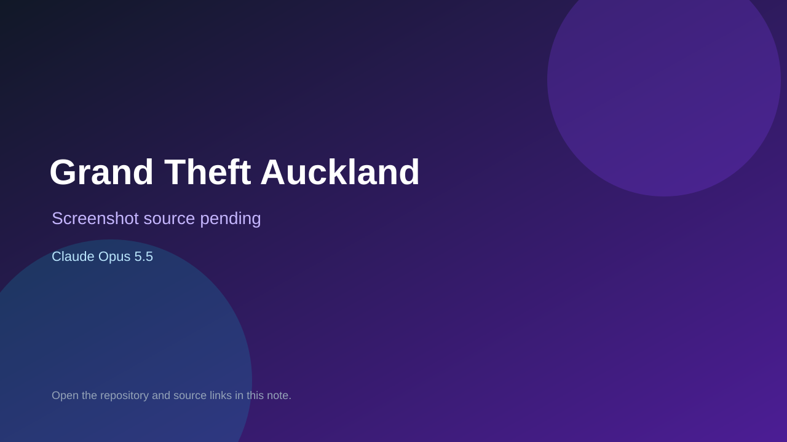

# Grand Theft Auckland

> Verified game note.

## At a glance

- **Score:** 7.3/10
- **Model:** Claude Opus 5.5
- **Technology:** TypeScript, Three.js, Browser
- **Estimated FP32 operations/s at 60 FPS:** 1,000,000,000 (low confidence; static estimate, not measured).
- **Rating basis:** Heuristic from source size, README and commit history (5.8 + 0.6*log10(code KB+1), +0.3 with a reachable demo); no runtime playtest.
- **Verified:** 2026-10-27
- **Repository:** [https://github.com/jay-aye-see-kay/grand-theft-auckland](https://github.com/jay-aye-see-kay/grand-theft-auckland)
- **Evidence:** [direct model evidence](https://github.com/jay-aye-see-kay/grand-theft-auckland/commit/4790f30c3b19965723bd3bbede930d932442928a)

## Screenshots

No screenshot source is recorded yet. Keep the placeholder until a repository, awesome list, or creator source provides an image.

## Model attribution

Open the evidence link above. Evidence grade: **direct model evidence**.

## Source description

A GTA III–flavoured open-world driving game set in Auckland, running in the. Commit carries an exact Claude Opus 5.5 co-author trailer. Source inspected from README, file tree and commit history only; no playtest.

### Gameplay source

- [https://github.com/jay-aye-see-kay/grand-theft-auckland/blob/claude/gta-style-auckland-game-pffg64/tools/citygen/roads.ts](https://github.com/jay-aye-see-kay/grand-theft-auckland/blob/claude/gta-style-auckland-game-pffg64/tools/citygen/roads.ts)
- [https://github.com/jay-aye-see-kay/grand-theft-auckland/commit/4790f30c3b19965723bd3bbede930d932442928a](https://github.com/jay-aye-see-kay/grand-theft-auckland/commit/4790f30c3b19965723bd3bbede930d932442928a)

## Verification notes

- **Status:** verified_source
- **Counted units in repository:** 1
- **Units covered by this note:** 1
- **Discovery:** GitHub commit pool: model+game commits 2026-10-26T07:00Z..2026-10-27T01:00Z (30-minute Opus 5.5 and 2-6 hour other-model UTC partitions, via gh-read) joined to repositories created after 2026-10-25T01:00Z; https://github.com/jay-aye-see-kay/grand-theft-auckland

[Back to the awesome list](../../README.md)
