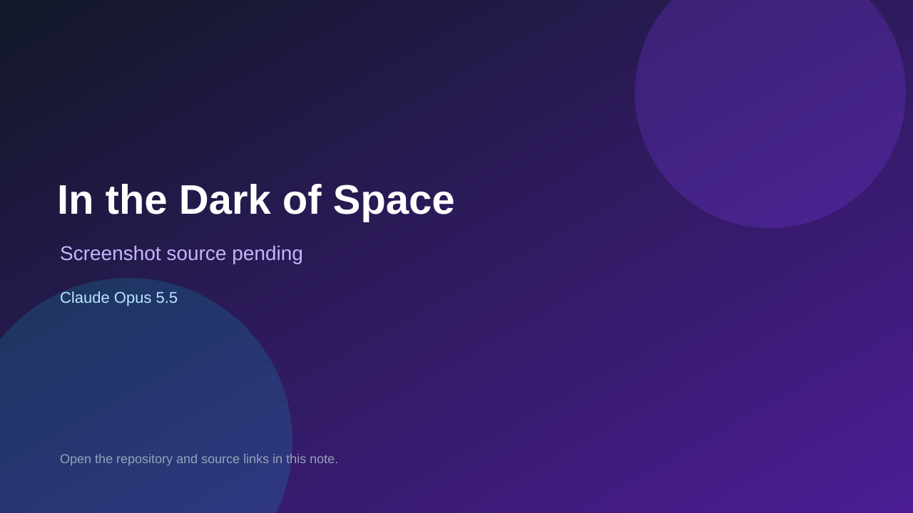

# In the Dark of Space

> Verified game note.

## At a glance

- **Score:** 7.1/10
- **Model:** Claude Opus 5.5
- **Technology:** JavaScript, Three.js, Browser
- **Estimated FP32 operations/s at 60 FPS:** 1,000,000,000 (low confidence; static estimate, not measured).
- **Rating basis:** Heuristic from source size, README and commit history (5.8 + 0.6*log10(code KB+1), +0.3 with a reachable demo); no runtime playtest.
- **Verified:** 2026-10-25
- **Repository:** [https://github.com/Wut-Lab/The-Dark-of-Space](https://github.com/Wut-Lab/The-Dark-of-Space)
- **Evidence:** [direct model evidence](https://github.com/Wut-Lab/The-Dark-of-Space/commit/deaf6bfec3cec116662ef3434fc555b4d826a51d)

## Screenshots

No screenshot source is recorded yet. Keep the placeholder until a repository, awesome list, or creator source provides an image.

## Model attribution

Open the evidence link above. Evidence grade: **direct model evidence**.

## Source description

A Galaga-style voxel shooter with roguelike runs. You pilot the Kestrel (a tough mobile frame), the Gale (a fast interceptor) or the Falcon (a balanced strike fighter) and hold the line against mass-production units that fly in, form up and dive at you. Commit carries an exact Claude Opus 5.5 co-author trailer. Source inspected from README, file tree and commit history only; no playtest.

### Gameplay source

- [https://github.com/Wut-Lab/The-Dark-of-Space/blob/main/index.html](https://github.com/Wut-Lab/The-Dark-of-Space/blob/main/index.html)
- [https://github.com/Wut-Lab/The-Dark-of-Space/commit/deaf6bfec3cec116662ef3434fc555b4d826a51d](https://github.com/Wut-Lab/The-Dark-of-Space/commit/deaf6bfec3cec116662ef3434fc555b4d826a51d)

## Verification notes

- **Status:** verified_source
- **Counted units in repository:** 1
- **Units covered by this note:** 1
- **Discovery:** GitHub commit pool: model+game commits 2026-10-24T01:00Z..2026-10-25T01:00Z (30-minute Opus 5.5 and wider other-model UTC partitions) joined to repositories created after 2026-10-23T01:00Z; https://github.com/Wut-Lab/The-Dark-of-Space

[Back to the awesome list](../../README.md)
