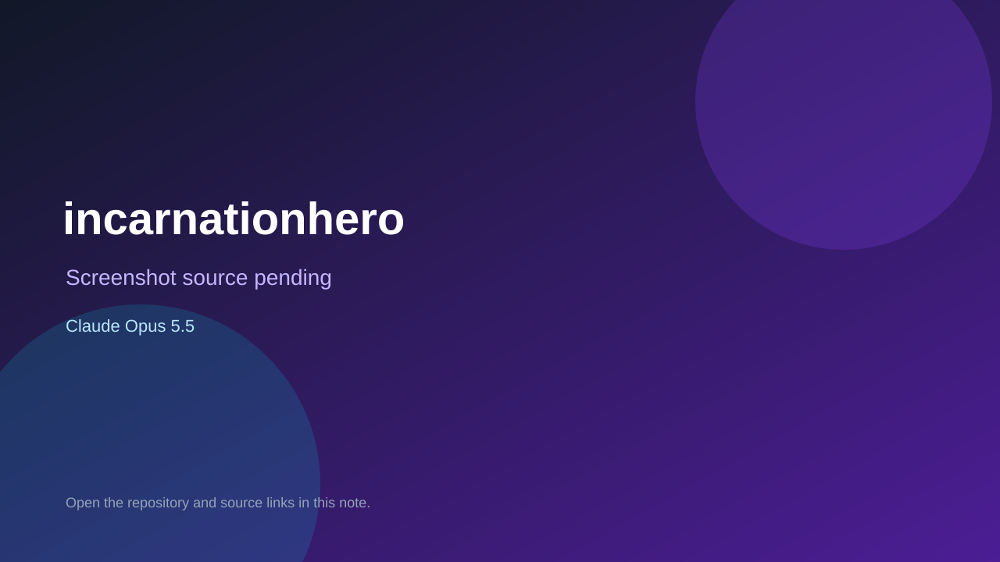

# incarnationhero

> Verified game note.

## At a glance

- **Score:** 7.3/10
- **Model:** Claude Opus 5.5
- **Technology:** C#
- **Estimated FP32 operations/s at 60 FPS:** 1,000,000 (low confidence; static estimate, not measured).
- **Rating basis:** Heuristic from source size, README and commit history (5.8 + 0.6*log10(code KB+1), +0.3 with a reachable demo); no runtime playtest.
- **Verified:** 2026-10-27
- **Repository:** [https://github.com/dobrogo-andrian/incarnation_hero](https://github.com/dobrogo-andrian/incarnation_hero)
- **Evidence:** [direct model evidence](https://github.com/dobrogo-andrian/incarnation_hero/commit/e4bacd30dc2f2687537d13b6712d1a60e61c82aa)

## Screenshots

No screenshot source is recorded yet. Keep the placeholder until a repository, awesome list, or creator source provides an image.

## Model attribution

Open the evidence link above. Evidence grade: **direct model evidence**.

## Source description

Покроковий рогалик у жанрі уся/сяня (робоча назва). Герой культивує ці, тренується, збирає знання й бореться на гексагональній сітці. Головний ресурс — час: 1 хід дорівнює тижню, і герой старіє. Після смерті в наступну реінкарнацію переходить лише резонанс… Commit carries an exact Claude Opus 5.5 co-author trailer. Source inspected from README, file tree and commit history only; no playtest.

### Gameplay source

- [https://github.com/dobrogo-andrian/incarnation_hero/blob/main/src/Core/Sim/SimText.cs](https://github.com/dobrogo-andrian/incarnation_hero/blob/main/src/Core/Sim/SimText.cs)
- [https://github.com/dobrogo-andrian/incarnation_hero/commit/e4bacd30dc2f2687537d13b6712d1a60e61c82aa](https://github.com/dobrogo-andrian/incarnation_hero/commit/e4bacd30dc2f2687537d13b6712d1a60e61c82aa)

## Verification notes

- **Status:** verified_source
- **Counted units in repository:** 1
- **Units covered by this note:** 1
- **Discovery:** GitHub commit pool: model+game commits 2026-10-26T07:00Z..2026-10-27T01:00Z (30-minute Opus 5.5 and 2-6 hour other-model UTC partitions, via gh-read) joined to repositories created after 2026-10-25T01:00Z; https://github.com/dobrogo-andrian/incarnation_hero

[Back to the awesome list](../../README.md)
