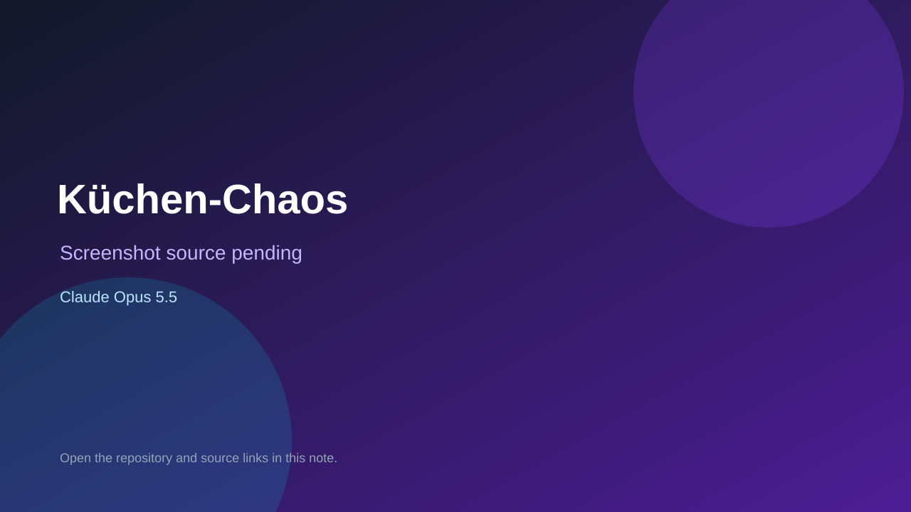

# Küchen-Chaos

> Verified game note.

## At a glance

- **Score:** 7.4/10
- **Model:** Claude Opus 5.5
- **Technology:** JavaScript, Browser
- **Estimated FP32 operations/s at 60 FPS:** 10,000,000 (low confidence; static estimate, not measured).
- **Rating basis:** Heuristic from source size, README and commit history (5.8 + 0.6*log10(code KB+1), +0.3 with a reachable demo); no runtime playtest.
- **Verified:** 2026-10-26
- **Repository:** [https://github.com/Ikarus-eth/CangguKitchen](https://github.com/Ikarus-eth/CangguKitchen)
- **Evidence:** [direct model evidence](https://github.com/Ikarus-eth/CangguKitchen/commit/c331f5fd22b2abfb07cd5961533b5c1ff2b97a25)

## Screenshots

No screenshot source is recorded yet. Keep the placeholder until a repository, awesome list, or creator source provides an image.

## Model attribution

Open the evidence link above. Evidence grade: **direct model evidence**.

## Source description

A real-time cooperative kitchen game for 1–4 players, one iPad each, played in the browser. It follows all eight scenarios and the five Master Chef missions of the Kitchen Rush revised rules, with its own dishes and artwork. Commit carries an exact Claude Opus 5.5 co-author trailer. Source inspected from README, file tree and commit history only; no playtest.

### Gameplay source

- [https://github.com/Ikarus-eth/CangguKitchen/blob/main/index.html](https://github.com/Ikarus-eth/CangguKitchen/blob/main/index.html)
- [https://github.com/Ikarus-eth/CangguKitchen/commit/c331f5fd22b2abfb07cd5961533b5c1ff2b97a25](https://github.com/Ikarus-eth/CangguKitchen/commit/c331f5fd22b2abfb07cd5961533b5c1ff2b97a25)

## Verification notes

- **Status:** verified_source
- **Counted units in repository:** 1
- **Units covered by this note:** 1
- **Discovery:** GitHub commit pool: model+game commits 2026-10-24T01:00Z..2026-10-26T01:00Z (30-minute Opus 5.5 partitions from 2026-10-24T20:00Z and wider other-model UTC partitions; covers windows left unsearched on 2026-10-25) joined to repositories created after 2026-10-23T01:00Z; https://github.com/Ikarus-eth/CangguKitchen

[Back to the awesome list](../../README.md)
