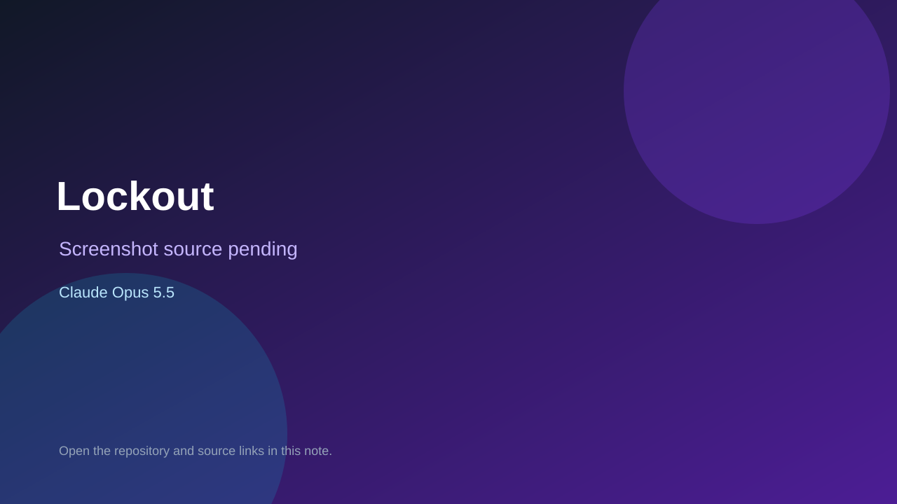

# Lockout

> Verified game note.

## At a glance

- **Score:** 7.4/10
- **Model:** Claude Opus 5.5
- **Technology:** JavaScript, Browser
- **Estimated FP32 operations/s at 60 FPS:** 10,000,000 (low confidence; static estimate, not measured).
- **Rating basis:** Heuristic from source size, README and commit history (5.8 + 0.6*log10(code KB+1), +0.3 with a reachable demo); no runtime playtest.
- **Verified:** 2026-10-27
- **Repository:** [https://github.com/TysonWoerdehoff/lockout](https://github.com/TysonWoerdehoff/lockout)
- **Evidence:** [direct model evidence](https://github.com/TysonWoerdehoff/lockout/commit/64758a1f9cc7b9e429c3c31a9701d56d99c6410e)

## Screenshots

No screenshot source is recorded yet. Keep the placeholder until a repository, awesome list, or creator source provides an image.

## Model attribution

Open the evidence link above. Evidence grade: **direct model evidence**.

## Source description

Real-life lockout bingo for you and your friends. Everyone joins a lobby on their phone, splits into teams, and races to claim squares on a shared board — every claim needs a video, and once a team locks a square nobody else can take it. Commit carries an exact Claude Opus 5.5 co-author trailer. Source inspected from README, file tree and commit history only; no playtest.

### Gameplay source

- [https://github.com/TysonWoerdehoff/lockout/blob/main/docs/app.js](https://github.com/TysonWoerdehoff/lockout/blob/main/docs/app.js)
- [https://github.com/TysonWoerdehoff/lockout/commit/64758a1f9cc7b9e429c3c31a9701d56d99c6410e](https://github.com/TysonWoerdehoff/lockout/commit/64758a1f9cc7b9e429c3c31a9701d56d99c6410e)

## Verification notes

- **Status:** verified_source
- **Counted units in repository:** 1
- **Units covered by this note:** 1
- **Discovery:** GitHub commit pool: model+game commits 2026-10-26T07:00Z..2026-10-27T01:00Z (30-minute Opus 5.5 and 2-6 hour other-model UTC partitions, via gh-read) joined to repositories created after 2026-10-25T01:00Z; https://github.com/TysonWoerdehoff/lockout

[Back to the awesome list](../../README.md)
