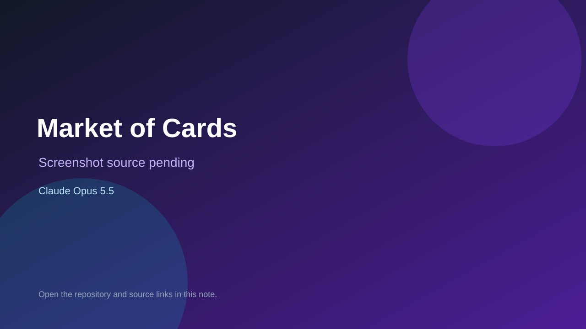

# Market of Cards

> Verified game note.

## At a glance

- **Score:** 7.0/10
- **Model:** Claude Opus 5.5
- **Technology:** JavaScript, Browser
- **Estimated FP32 operations/s at 60 FPS:** 10,000,000 (low confidence; static estimate, not measured).
- **Rating basis:** Heuristic from source size, README and commit history (5.8 + 0.6*log10(code KB+1), +0.3 with a reachable demo); no runtime playtest.
- **Verified:** 2026-10-27
- **Repository:** [https://github.com/shivaxelquant/market_making_game](https://github.com/shivaxelquant/market_making_game)
- **Evidence:** [direct model evidence](https://github.com/shivaxelquant/market_making_game/commit/2571a6a97e60e55beb3d053317fd3e3aaa90fcff)

## Screenshots

No screenshot source is recorded yet. Keep the placeholder until a repository, awesome list, or creator source provides an image.

## Model attribution

Open the evidence link above. Evidence grade: **direct model evidence**.

## Source description

A group market-making card game you play in the browser against Bayesian bots. Every card on the table adds to one hidden total. You quote it, trade it, and read the other players' markets before the centre cards turn. Commit carries an exact Claude Opus 5.5 co-author trailer. Source inspected from README, file tree and commit history only; no playtest.

### Gameplay source

- [https://github.com/shivaxelquant/market_making_game/blob/main/index.html](https://github.com/shivaxelquant/market_making_game/blob/main/index.html)
- [https://github.com/shivaxelquant/market_making_game/commit/2571a6a97e60e55beb3d053317fd3e3aaa90fcff](https://github.com/shivaxelquant/market_making_game/commit/2571a6a97e60e55beb3d053317fd3e3aaa90fcff)

## Verification notes

- **Status:** verified_source
- **Counted units in repository:** 1
- **Units covered by this note:** 1
- **Discovery:** GitHub commit pool: model+game commits 2026-10-26T07:00Z..2026-10-27T01:00Z (30-minute Opus 5.5 and 2-6 hour other-model UTC partitions, via gh-read) joined to repositories created after 2026-10-25T01:00Z; https://github.com/shivaxelquant/market_making_game

[Back to the awesome list](../../README.md)
