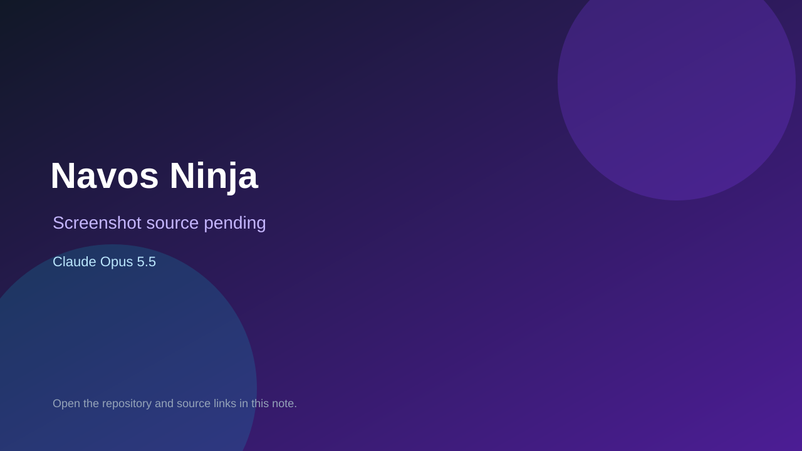

# Navos Ninja

> Verified game note.

## At a glance

- **Score:** 7.4/10
- **Model:** Claude Opus 5.5
- **Technology:** JavaScript, Browser
- **Estimated FP32 operations/s at 60 FPS:** 100,000,000 (low confidence; static estimate, not measured).
- **Rating basis:** Heuristic from source size, README and commit history (5.8 + 0.6*log10(code KB+1), +0.3 with a reachable demo); no runtime playtest.
- **Verified:** 2026-10-25
- **Repository:** [https://github.com/aaronseaman/fun](https://github.com/aaronseaman/fun)
- **Evidence:** [direct model evidence](https://github.com/aaronseaman/fun/commit/141433f1cc2d3aba6d8b9ef794a22b5f356870ec)
- **Live demo:** [open demo](https://aaronseaman.github.io/fun/)

## Screenshots

No screenshot source is recorded yet. Keep the placeholder until a repository, awesome list, or creator source provides an image.

## Model attribution

Open the evidence link above. Evidence grade: **direct model evidence**.

## Source description

A polished, top-down five-minute survival roguelite for the browser. You play a tanned ninja in khaki scrubs with a katana, holding out against swarms of silly four-legged monsters. Your weapons attack on their own; your job is to move, dodge, collect XP and… Commit carries an exact Claude Opus 5.5 co-author trailer. Live demo returned HTTP 200 (availability only, not a playtest). Source inspected from README, file tree and commit history only; no playtest.

### Gameplay source

- [https://github.com/aaronseaman/fun/blob/main/game.js](https://github.com/aaronseaman/fun/blob/main/game.js)
- [https://github.com/aaronseaman/fun/commit/141433f1cc2d3aba6d8b9ef794a22b5f356870ec](https://github.com/aaronseaman/fun/commit/141433f1cc2d3aba6d8b9ef794a22b5f356870ec)

## Verification notes

- **Status:** verified_source
- **Counted units in repository:** 1
- **Units covered by this note:** 1
- **Discovery:** GitHub commit pool: model+game commits 2026-10-24T01:00Z..2026-10-25T01:00Z (30-minute Opus 5.5 and wider other-model UTC partitions) joined to repositories created after 2026-10-23T01:00Z; https://github.com/aaronseaman/fun

[Back to the awesome list](../../README.md)
