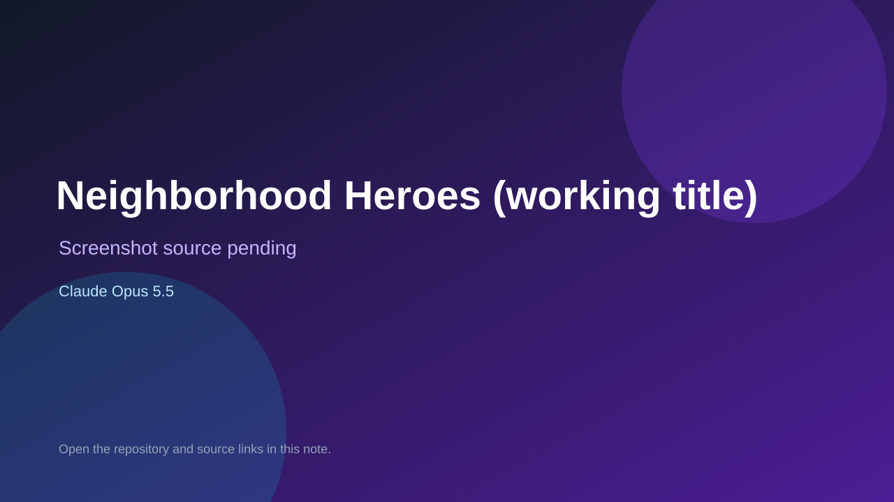

# Neighborhood Heroes (working title)

> Verified game note.

## At a glance

- **Score:** 8.0/10
- **Model:** Claude Opus 5.5
- **Technology:** JavaScript, Browser
- **Estimated FP32 operations/s at 60 FPS:** 10,000,000 (low confidence; static estimate, not measured).
- **Rating basis:** Heuristic from source size, README and commit history (5.8 + 0.6*log10(code KB+1), +0.3 with a reachable demo); no runtime playtest.
- **Verified:** 2026-10-27
- **Repository:** [https://github.com/DempKing/Neighborhood_Heroes](https://github.com/DempKing/Neighborhood_Heroes)
- **Evidence:** [direct model evidence](https://github.com/DempKing/Neighborhood_Heroes/commit/cf44ece389579ff70c2df3e1032fea22d223eed6)
- **Live demo:** [open demo](https://dempking.github.io/Neighborhood_Heroes/)

## Screenshots

No screenshot source is recorded yet. Keep the placeholder until a repository, awesome list, or creator source provides an image.

## Model attribution

Open the evidence link above. Evidence grade: **direct model evidence**.

## Source description

A hand-drawn 2D cartoon life sim and sports team management game, seen from a 3/4 top-down view. You're a 3rd grader starting a sports team: you recruit kids from around town, earn money for shirts and the league fee, keep your grades up, and take a backyard… Commit carries an exact Claude Opus 5.5 co-author trailer. Live demo returned HTTP 200 (availability only, not a playtest). Source inspected from README, file tree and commit history only; no playtest.

### Gameplay source

- [https://github.com/DempKing/Neighborhood_Heroes/blob/main/src/data/renders.js](https://github.com/DempKing/Neighborhood_Heroes/blob/main/src/data/renders.js)
- [https://github.com/DempKing/Neighborhood_Heroes/commit/cf44ece389579ff70c2df3e1032fea22d223eed6](https://github.com/DempKing/Neighborhood_Heroes/commit/cf44ece389579ff70c2df3e1032fea22d223eed6)

## Verification notes

- **Status:** verified_source
- **Counted units in repository:** 1
- **Units covered by this note:** 1
- **Discovery:** GitHub commit pool: model+game commits 2026-10-26T07:00Z..2026-10-27T01:00Z (30-minute Opus 5.5 and 2-6 hour other-model UTC partitions, via gh-read) joined to repositories created after 2026-10-25T01:00Z; https://github.com/DempKing/Neighborhood_Heroes

[Back to the awesome list](../../README.md)
