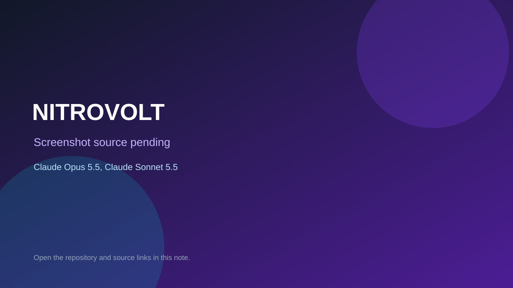

# NITROVOLT

> Verified game note.

## At a glance

- **Score:** 7.5/10
- **Model:** Claude Opus 5.5, Claude Sonnet 5.5
- **Technology:** TypeScript, Three.js, React, Browser
- **Estimated FP32 operations/s at 60 FPS:** 1,000,000,000 (low confidence; static estimate, not measured).
- **Rating basis:** Heuristic from source size, README and commit history (5.8 + 0.6*log10(code KB+1), +0.3 with a reachable demo); no runtime playtest.
- **Verified:** 2026-10-25
- **Repository:** [https://github.com/Coder-4847/Nitrovolt](https://github.com/Coder-4847/Nitrovolt)
- **Evidence:** [direct model evidence](https://github.com/Coder-4847/Nitrovolt/commit/3dafd0c6759d39f2c668e4a0710886ab393c67c1)

## Screenshots

No screenshot source is recorded yet. Keep the placeholder until a repository, awesome list, or creator source provides an image.

## Model attribution

Open the evidence link above. Evidence grade: **direct model evidence**.

## Source description

A browser time-attack racer: big hand-built tracks through forest, snow and desert, car switches mid-run, wall turns,. Commit carries an exact Claude Opus 5.5 / Claude Sonnet 5.5 co-author trailer. Source inspected from README, file tree and commit history only; no playtest.

### Gameplay source

- [https://github.com/Coder-4847/Nitrovolt/blob/claude/adoring-wright-8tz8fj/src/physics/Vehicle.ts](https://github.com/Coder-4847/Nitrovolt/blob/claude/adoring-wright-8tz8fj/src/physics/Vehicle.ts)
- [https://github.com/Coder-4847/Nitrovolt/commit/3dafd0c6759d39f2c668e4a0710886ab393c67c1](https://github.com/Coder-4847/Nitrovolt/commit/3dafd0c6759d39f2c668e4a0710886ab393c67c1)

## Verification notes

- **Status:** verified_source
- **Counted units in repository:** 1
- **Units covered by this note:** 1
- **Discovery:** GitHub commit pool: model+game commits 2026-10-23T01:00Z..2026-10-24T01:00Z (30-minute Opus 5.5 and wider other-model UTC partitions) joined to repositories created after 2026-10-22T01:00Z; carried over from the 2026-10-24 pending list; https://github.com/Coder-4847/Nitrovolt

[Back to the awesome list](../../README.md)
