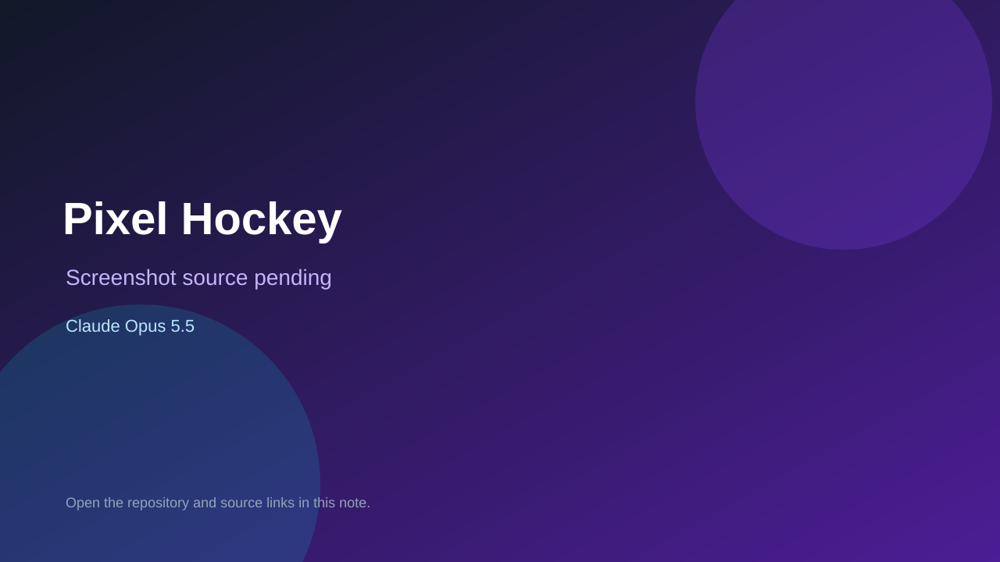

# Pixel Hockey

> Verified game note.

## At a glance

- **Score:** 7.6/10
- **Model:** Claude Opus 5.5
- **Technology:** TypeScript, React, Browser
- **Estimated FP32 operations/s at 60 FPS:** 10,000,000 (low confidence; static estimate, not measured).
- **Rating basis:** Heuristic from source size, README and commit history (5.8 + 0.6*log10(code KB+1), +0.3 with a reachable demo); no runtime playtest.
- **Verified:** 2026-10-25
- **Repository:** [https://github.com/ybelov27/pixel-hockey](https://github.com/ybelov27/pixel-hockey)
- **Evidence:** [direct model evidence](https://github.com/ybelov27/pixel-hockey/commit/22f6adc63d15dea3e394a0b07851f8599df267c6)
- **Live demo:** [open demo](https://ybelov27.github.io/pixel-hockey/)

## Screenshots

No screenshot source is recorded yet. Keep the placeholder until a repository, awesome list, or creator source provides an image.

## Model attribution

Open the evidence link above. Evidence grade: **direct model evidence**.

## Source description

A retro pixel-art ice hockey game for the web, with a chunky sports-game look inspired by classics like Retro Bowl and NHL '94. It has all 32 NHL teams, full seasons, NHL-format playoffs, shootouts and touch controls. Add it to your iPhone or iPad home screen… Commit carries an exact Claude Opus 5.5 co-author trailer. Live demo returned HTTP 200 (availability only, not a playtest). Source inspected from README, file tree and commit history only; no playtest.

### Gameplay source

- [https://github.com/ybelov27/pixel-hockey/blob/claude/dazzling-newton-r95x8e/src/game/match.ts](https://github.com/ybelov27/pixel-hockey/blob/claude/dazzling-newton-r95x8e/src/game/match.ts)
- [https://github.com/ybelov27/pixel-hockey/commit/22f6adc63d15dea3e394a0b07851f8599df267c6](https://github.com/ybelov27/pixel-hockey/commit/22f6adc63d15dea3e394a0b07851f8599df267c6)

## Verification notes

- **Status:** verified_source
- **Counted units in repository:** 1
- **Units covered by this note:** 1
- **Discovery:** GitHub commit pool: model+game commits 2026-10-23T01:00Z..2026-10-24T01:00Z (30-minute Opus 5.5 and wider other-model UTC partitions) joined to repositories created after 2026-10-22T01:00Z; carried over from the 2026-10-24 pending list; https://github.com/ybelov27/pixel-hockey

[Back to the awesome list](../../README.md)
