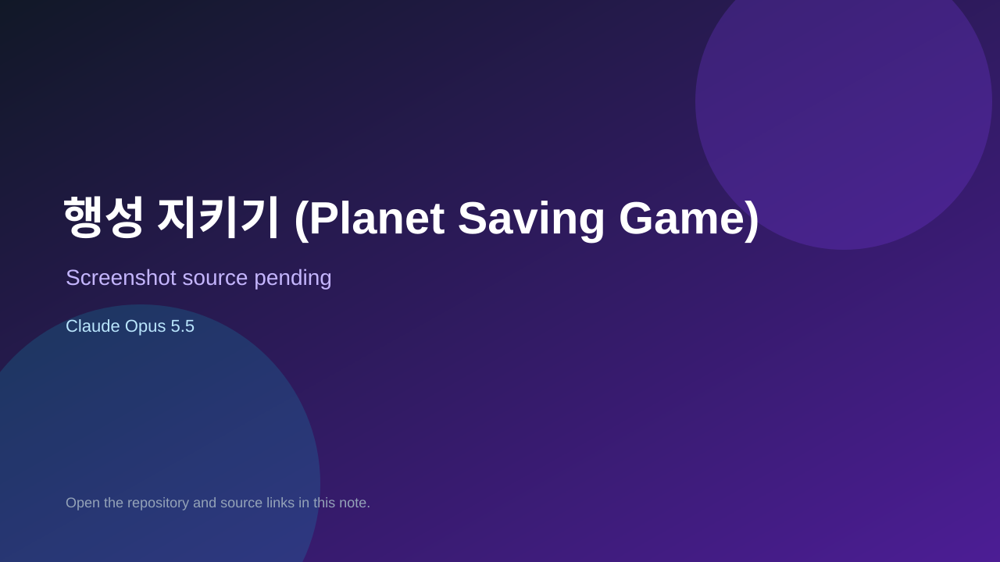

# 행성 지키기 (Planet Saving Game)

> Verified game note.

## At a glance

- **Score:** 7.3/10
- **Model:** Claude Opus 5.5
- **Technology:** TypeScript, Browser
- **Estimated FP32 operations/s at 60 FPS:** 100,000,000 (low confidence; static estimate, not measured).
- **Rating basis:** Heuristic from source size, README and commit history (5.8 + 0.6*log10(code KB+1), +0.3 with a reachable demo); no runtime playtest.
- **Verified:** 2026-10-26
- **Repository:** [https://github.com/JMH-Chem/Planet-Saving-Game](https://github.com/JMH-Chem/Planet-Saving-Game)
- **Evidence:** [direct model evidence](https://github.com/JMH-Chem/Planet-Saving-Game/commit/c6a3a0de12949fc6ba27a94ec07f83fd8bbaec8e)

## Screenshots

No screenshot source is recorded yet. Keep the placeholder until a repository, awesome list, or creator source provides an image.

## Model attribution

Open the evidence link above. Evidence grade: **direct model evidence**.

## Source description

행성이 만들어내는 병력을 드래그로 원하는 만큼 떼어내 움직이고, 적 행성에 뭉쳐서 돌파할지 / 둘러싸서 수비대부터 깎을지를. Commit carries an exact Claude Opus 5.5 co-author trailer. Source inspected from README, file tree and commit history only; no playtest.

### Gameplay source

- [https://github.com/JMH-Chem/Planet-Saving-Game/blob/claude/gracious-tesla-twxvix/src/input/controller.ts](https://github.com/JMH-Chem/Planet-Saving-Game/blob/claude/gracious-tesla-twxvix/src/input/controller.ts)
- [https://github.com/JMH-Chem/Planet-Saving-Game/commit/c6a3a0de12949fc6ba27a94ec07f83fd8bbaec8e](https://github.com/JMH-Chem/Planet-Saving-Game/commit/c6a3a0de12949fc6ba27a94ec07f83fd8bbaec8e)

## Verification notes

- **Status:** verified_source
- **Counted units in repository:** 1
- **Units covered by this note:** 1
- **Discovery:** GitHub commit pool: model+game commits 2026-10-24T01:00Z..2026-10-26T01:00Z (30-minute Opus 5.5 partitions from 2026-10-24T20:00Z and wider other-model UTC partitions; covers windows left unsearched on 2026-10-25) joined to repositories created after 2026-10-23T01:00Z; https://github.com/JMH-Chem/Planet-Saving-Game

[Back to the awesome list](../../README.md)
