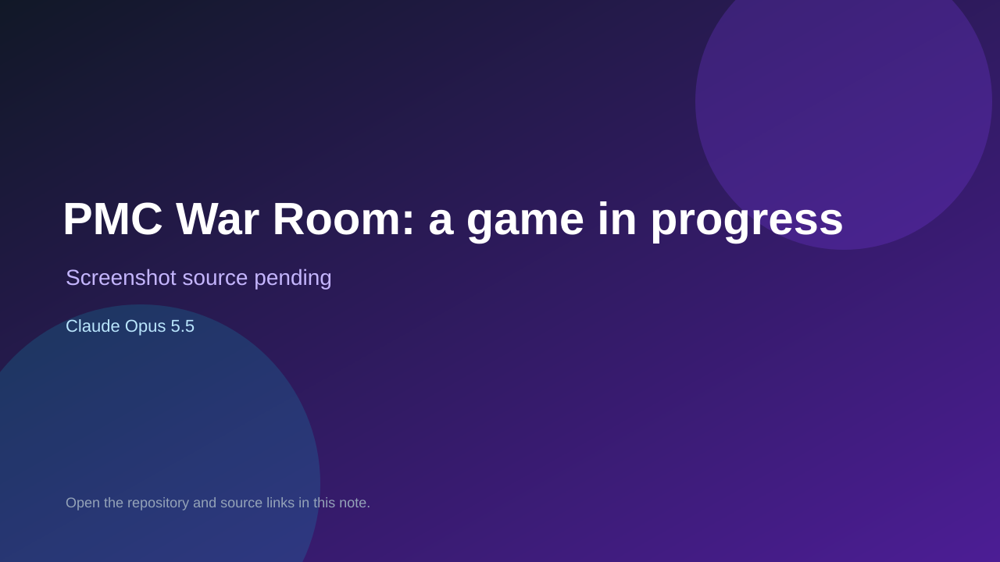

# PMC War Room: a game in progress

> Verified game note.

## At a glance

- **Score:** 7.7/10
- **Model:** Claude Opus 5.5
- **Technology:** TypeScript, Phaser, React, Browser
- **Estimated FP32 operations/s at 60 FPS:** 100,000,000 (low confidence; static estimate, not measured).
- **Rating basis:** Heuristic from source size, README and commit history (5.8 + 0.6*log10(code KB+1), +0.3 with a reachable demo); no runtime playtest.
- **Verified:** 2026-10-27
- **Repository:** [https://github.com/chadbercea/topo-map](https://github.com/chadbercea/topo-map)
- **Evidence:** [direct model evidence](https://github.com/chadbercea/topo-map/commit/5550f073291b68e47389c7c30387a9db3a459f69)
- **Live demo:** [open demo](https://topo-map-nu.vercel.app)
- **Additional live link:** [open demo](https://topo-map-nu.vercel.app/game/)
- **Additional live link:** [open demo](https://chadbercea.github.io/topo-map/war-room.html)
- **Additional live link:** [open demo](https://chadbercea.github.io/topo-map/)

## Screenshots

No screenshot source is recorded yet. Keep the placeholder until a repository, awesome list, or creator source provides an image.

## Model attribution

Open the evidence link above. Evidence grade: **direct model evidence**.

## Source description

This repo is PMC War Room, a game I'm developing with Claude, Anthropic's AI, in Claude Code. It's the reverse of a squad shooter. You don't control the soldiers. You're the war room of a private military company, supporting five contractors on the ground… Commit carries an exact Claude Opus 5.5 co-author trailer. Live demo returned HTTP 200 (availability only, not a playtest). Source inspected from README, file tree and commit history only; no playtest.

### Gameplay source

- [https://github.com/chadbercea/topo-map/blob/main/ground-truth.html](https://github.com/chadbercea/topo-map/blob/main/ground-truth.html)
- [https://github.com/chadbercea/topo-map/commit/5550f073291b68e47389c7c30387a9db3a459f69](https://github.com/chadbercea/topo-map/commit/5550f073291b68e47389c7c30387a9db3a459f69)

## Verification notes

- **Status:** verified_source
- **Counted units in repository:** 1
- **Units covered by this note:** 1
- **Discovery:** GitHub commit pool: model+game commits 2026-10-26T07:00Z..2026-10-27T01:00Z (30-minute Opus 5.5 and 2-6 hour other-model UTC partitions, via gh-read) joined to repositories created after 2026-10-25T01:00Z; https://github.com/chadbercea/topo-map

[Back to the awesome list](../../README.md)
