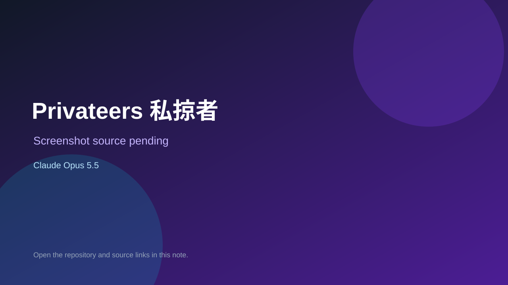

# Privateers 私掠者

> Verified game note.

## At a glance

- **Score:** 7.9/10
- **Model:** Claude Opus 5.5
- **Technology:** JavaScript, Phaser, Browser
- **Estimated FP32 operations/s at 60 FPS:** 100,000,000 (low confidence; static estimate, not measured).
- **Rating basis:** Heuristic from source size, README and commit history (5.8 + 0.6*log10(code KB+1), +0.3 with a reachable demo); no runtime playtest.
- **Verified:** 2026-10-25
- **Repository:** [https://github.com/howwmingnew/Privateers](https://github.com/howwmingnew/Privateers)
- **Evidence:** [direct model evidence](https://github.com/howwmingnew/Privateers/commit/a50b4cea9e66a1652e0c4428b71005734ed0bdd5)
- **Live demo:** [open demo](https://howwmingnew.github.io/Privateers/)
- **Additional live link:** [open demo](https://howwmingnew.github.io/Privateers/roadmap/)

## Screenshots

No screenshot source is recorded yet. Keep the placeholder until a repository, awesome list, or creator source provides an image.

## Model attribution

Open the evidence link above. Evidence grade: **direct model evidence**.

## Source description

俯視角海盜海戰網頁遊戲 · A top-down pirate naval battle browser game built with Phaser 3. Commit carries an exact Claude Opus 5.5 co-author trailer. Live demo returned HTTP 200 (availability only, not a playtest). Source inspected from README, file tree and commit history only; no playtest.

### Gameplay source

- [https://github.com/howwmingnew/Privateers/blob/main/roadmap/issues.js](https://github.com/howwmingnew/Privateers/blob/main/roadmap/issues.js)
- [https://github.com/howwmingnew/Privateers/commit/a50b4cea9e66a1652e0c4428b71005734ed0bdd5](https://github.com/howwmingnew/Privateers/commit/a50b4cea9e66a1652e0c4428b71005734ed0bdd5)

## Verification notes

- **Status:** verified_source
- **Counted units in repository:** 1
- **Units covered by this note:** 1
- **Discovery:** GitHub commit pool: model+game commits 2026-10-24T01:00Z..2026-10-25T01:00Z (30-minute Opus 5.5 and wider other-model UTC partitions) joined to repositories created after 2026-10-23T01:00Z; https://github.com/howwmingnew/Privateers

[Back to the awesome list](../../README.md)
