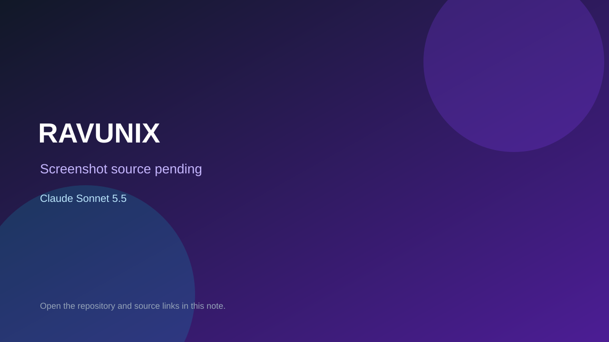

# RAVUNIX

> Verified game note.

## At a glance

- **Score:** 7.0/10
- **Model:** Claude Sonnet 5.5
- **Technology:** JavaScript, Three.js, Browser
- **Estimated FP32 operations/s at 60 FPS:** 1,000,000,000 (low confidence; static estimate, not measured).
- **Rating basis:** Heuristic from source size, README and commit history (5.8 + 0.6*log10(code KB+1), +0.3 with a reachable demo); no runtime playtest.
- **Verified:** 2026-10-26
- **Repository:** [https://github.com/epicecho992-ctrl/ravunix-game](https://github.com/epicecho992-ctrl/ravunix-game)
- **Evidence:** [direct model evidence](https://github.com/epicecho992-ctrl/ravunix-game/commit/24d68dff30bc36c6e6a218f92bc08f4dd1fa5b5d)

## Screenshots

No screenshot source is recorded yet. Keep the placeholder until a repository, awesome list, or creator source provides an image.

## Model attribution

Open the evidence link above. Evidence grade: **direct model evidence**.

## Source description

3D horror escape game (Three.js, single player, PC + mobile). Basement se shuru karo, fuse dhundo, generator chalao, chaabiyan jama karo, chhat se pipe pakad ke bhaag jao. Commit carries an exact Claude Sonnet 5.5 co-author trailer. Source inspected from README, file tree and commit history only; no playtest.

### Gameplay source

- [https://github.com/epicecho992-ctrl/ravunix-game/blob/main/js/main.js](https://github.com/epicecho992-ctrl/ravunix-game/blob/main/js/main.js)
- [https://github.com/epicecho992-ctrl/ravunix-game/commit/24d68dff30bc36c6e6a218f92bc08f4dd1fa5b5d](https://github.com/epicecho992-ctrl/ravunix-game/commit/24d68dff30bc36c6e6a218f92bc08f4dd1fa5b5d)

## Verification notes

- **Status:** verified_source
- **Counted units in repository:** 1
- **Units covered by this note:** 1
- **Discovery:** GitHub commit pool: model+game commits 2026-10-26T01:00Z..07:00Z (30-minute Opus 5.5 and 2-6 hour other-model UTC partitions, via gh-read) joined to repositories created after 2026-10-24T01:00Z; https://github.com/epicecho992-ctrl/ravunix-game

[Back to the awesome list](../../README.md)
