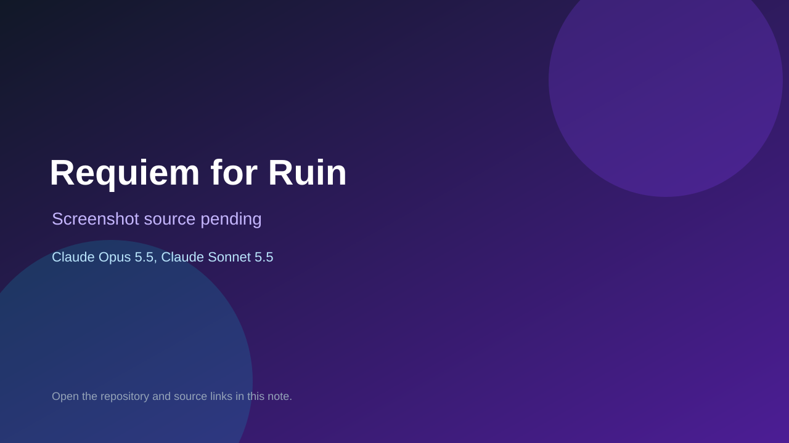

# Requiem for Ruin

> Verified game note.

## At a glance

- **Score:** 7.6/10
- **Model:** Claude Opus 5.5, Claude Sonnet 5.5
- **Technology:** JavaScript, Browser
- **Estimated FP32 operations/s at 60 FPS:** 100,000,000 (low confidence; static estimate, not measured).
- **Rating basis:** Heuristic from source size, README and commit history (5.8 + 0.6*log10(code KB+1), +0.3 with a reachable demo); no runtime playtest.
- **Verified:** 2026-10-26
- **Repository:** [https://github.com/rydevops/ffvis-](https://github.com/rydevops/ffvis-)
- **Evidence:** [direct model evidence](https://github.com/rydevops/ffvis-/commit/21f1e5452a99c41a054ecdbabf75c8056d73dc0f)

## Screenshots

No screenshot source is recorded yet. Keep the placeholder until a repository, awesome list, or creator source provides an image.

## Model attribution

Open the evidence link above. Evidence grade: **direct model evidence**.

## Source description

An unofficial, fan-made 16-bit RPG set one year after the World of Ruin, built as an. Commit carries an exact Claude Opus 5.5 / Claude Sonnet 5.5 co-author trailer. Source inspected from README, file tree and commit history only; no playtest.

### Gameplay source

- [https://github.com/rydevops/ffvis-/blob/main/js/scenes/battle.js](https://github.com/rydevops/ffvis-/blob/main/js/scenes/battle.js)
- [https://github.com/rydevops/ffvis-/commit/21f1e5452a99c41a054ecdbabf75c8056d73dc0f](https://github.com/rydevops/ffvis-/commit/21f1e5452a99c41a054ecdbabf75c8056d73dc0f)

## Verification notes

- **Status:** verified_source
- **Counted units in repository:** 1
- **Units covered by this note:** 1
- **Discovery:** GitHub commit pool: model+game commits 2026-10-26T01:00Z..07:00Z (30-minute Opus 5.5 and 2-6 hour other-model UTC partitions, via gh-read) joined to repositories created after 2026-10-24T01:00Z; https://github.com/rydevops/ffvis-

[Back to the awesome list](../../README.md)
