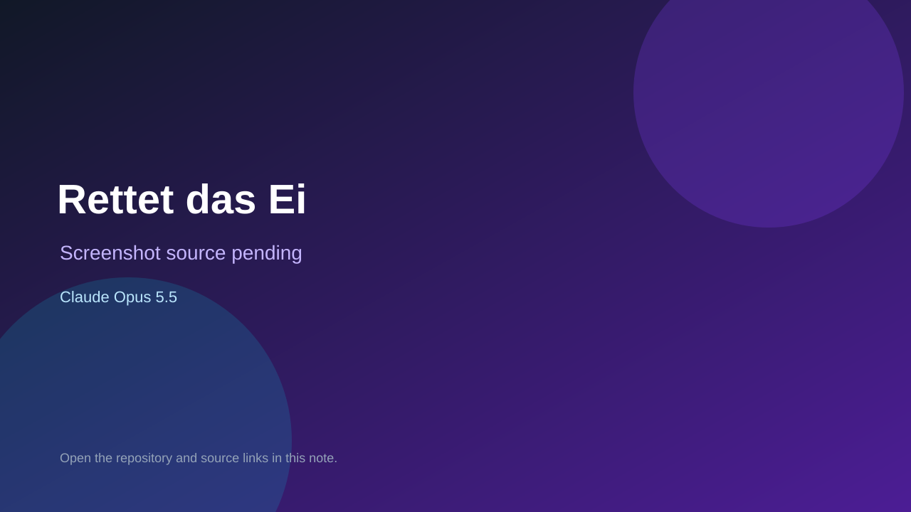

# Rettet das Ei

> Verified game note.

## At a glance

- **Score:** 7.1/10
- **Model:** Claude Opus 5.5
- **Technology:** C#
- **Estimated FP32 operations/s at 60 FPS:** 1,000,000 (low confidence; static estimate, not measured).
- **Rating basis:** Heuristic from source size, README and commit history (5.8 + 0.6*log10(code KB+1), +0.3 with a reachable demo); no runtime playtest.
- **Verified:** 2026-10-25
- **Repository:** [https://github.com/SaftKinn/eigame](https://github.com/SaftKinn/eigame)
- **Evidence:** [direct model evidence](https://github.com/SaftKinn/eigame/commit/3c88904a2b22da4778e7a446e3204ce895638745)

## Screenshots

No screenshot source is recorded yet. Keep the placeholder until a repository, awesome list, or creator source provides an image.

## Model attribution

Open the evidence link above. Evidence grade: **direct model evidence**.

## Source description

wobbly tower on a cutting board, and keep the egg on top alive while ants, meatballs, fruit flies. Commit carries an exact Claude Opus 5.5 co-author trailer. Source inspected from README, file tree and commit history only; no playtest.

### Gameplay source

- [https://github.com/SaftKinn/eigame/blob/main/game/scripts/Main.cs](https://github.com/SaftKinn/eigame/blob/main/game/scripts/Main.cs)
- [https://github.com/SaftKinn/eigame/commit/3c88904a2b22da4778e7a446e3204ce895638745](https://github.com/SaftKinn/eigame/commit/3c88904a2b22da4778e7a446e3204ce895638745)

## Verification notes

- **Status:** verified_source
- **Counted units in repository:** 1
- **Units covered by this note:** 1
- **Discovery:** GitHub commit pool: model+game commits 2026-10-24T01:00Z..2026-10-25T01:00Z (30-minute Opus 5.5 and wider other-model UTC partitions) joined to repositories created after 2026-10-23T01:00Z; https://github.com/SaftKinn/eigame

[Back to the awesome list](../../README.md)
