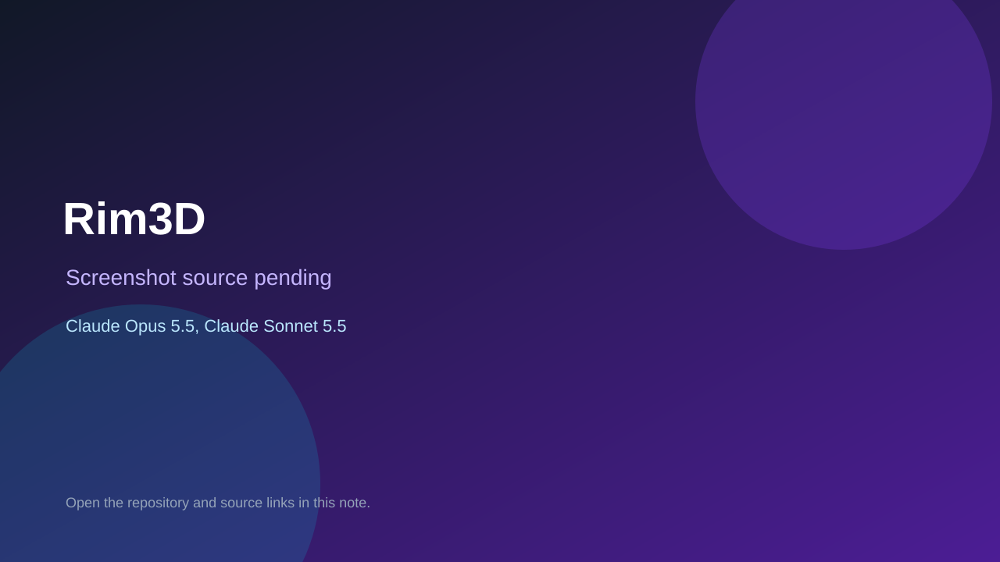

# Rim3D

> Top-list entry: **today** (#10).

## At a glance

- **Score:** 8.0/10
- **Model:** Claude Opus 5.5, Claude Sonnet 5.5
- **Technology:** Unreal Engine, C++
- **Estimated FP32 operations/s at 60 FPS:** 1,000,000,000 (low confidence; static estimate, not measured).
- **Rating basis:** Heuristic from source size, README and commit history (5.8 + 0.6*log10(code KB+1), +0.3 with a reachable demo); no runtime playtest.
- **Verified:** 2026-10-26
- **Repository:** [https://github.com/Sneed-code/Rim3D](https://github.com/Sneed-code/Rim3D)
- **Evidence:** [direct model evidence](https://github.com/Sneed-code/Rim3D/commit/96b2d100e89cafc4bbbde15e4643108ab12ea370)

## Screenshots

No screenshot source is recorded yet. Keep the placeholder until a repository, awesome list, or creator source provides an image.

## Model attribution

Open the evidence link above. Evidence grade: **direct model evidence**.

## Source description

A private, single-player 3D colony game built in Unreal Engine 5, closely based on RimWorld and its expansions. You play one colonist in first or third person, or oversee the whole colony from above. The story is our own: a frontier world in the year 6650… Commit carries an exact Claude Opus 5.5 / Claude Sonnet 5.5 co-author trailer. Source inspected from README, file tree and commit history only; no playtest.

### Gameplay source

- [https://github.com/Sneed-code/Rim3D/blob/main/game/Plugins/ColonySim/Source/ColonySim/Private/Save.cpp](https://github.com/Sneed-code/Rim3D/blob/main/game/Plugins/ColonySim/Source/ColonySim/Private/Save.cpp)
- [https://github.com/Sneed-code/Rim3D/commit/96b2d100e89cafc4bbbde15e4643108ab12ea370](https://github.com/Sneed-code/Rim3D/commit/96b2d100e89cafc4bbbde15e4643108ab12ea370)

## Verification notes

- **Status:** verified_source
- **Counted units in repository:** 1
- **Units covered by this note:** 1
- **Discovery:** GitHub commit pool: model+game commits 2026-10-24T01:00Z..2026-10-26T01:00Z (30-minute Opus 5.5 partitions from 2026-10-24T20:00Z and wider other-model UTC partitions; covers windows left unsearched on 2026-10-25) joined to repositories created after 2026-10-23T01:00Z; https://github.com/Sneed-code/Rim3D

[Back to the awesome list](../../README.md)
