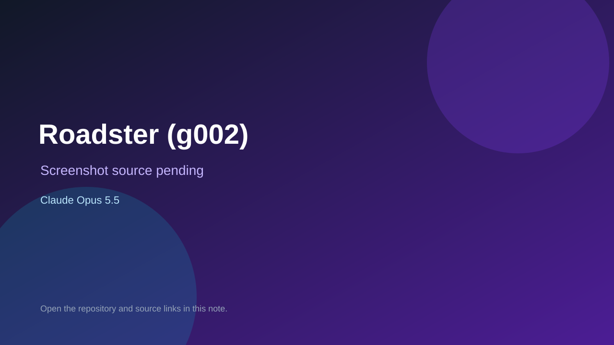

# Roadster (g002)

> Verified game note.

## At a glance

- **Score:** 7.5/10
- **Model:** Claude Opus 5.5
- **Technology:** TypeScript, Three.js, Browser
- **Estimated FP32 operations/s at 60 FPS:** 1,000,000,000 (low confidence; static estimate, not measured).
- **Rating basis:** Heuristic from source size, README and commit history (5.8 + 0.6*log10(code KB+1), +0.3 with a reachable demo); no runtime playtest.
- **Verified:** 2026-10-25
- **Repository:** [https://github.com/kovaforge-games/g002-racing-roadster](https://github.com/kovaforge-games/g002-racing-roadster)
- **Evidence:** [direct model evidence](https://github.com/kovaforge-games/g002-racing-roadster/commit/71634fbaffbc77cc2893b063e431f6ef1b12fdd0)

## Screenshots

No screenshot source is recorded yet. Keep the placeholder until a repository, awesome list, or creator source provides an image.

## Model attribution

Open the evidence link above. Evidence grade: **direct model evidence**.

## Source description

A 3D browser racing game starring an electric sports car, built with three.js and Rapier physics. Race up to 11 AI bots at five difficulty levels, with cold-gas thrusters for boosts, hops and flips, a chase camera, and handling tuned to feel good on a… Commit carries an exact Claude Opus 5.5 co-author trailer. Source inspected from README, file tree and commit history only; no playtest.

### Gameplay source

- [https://github.com/kovaforge-games/g002-racing-roadster/blob/main/src/game.ts](https://github.com/kovaforge-games/g002-racing-roadster/blob/main/src/game.ts)
- [https://github.com/kovaforge-games/g002-racing-roadster/commit/71634fbaffbc77cc2893b063e431f6ef1b12fdd0](https://github.com/kovaforge-games/g002-racing-roadster/commit/71634fbaffbc77cc2893b063e431f6ef1b12fdd0)

## Verification notes

- **Status:** verified_source
- **Counted units in repository:** 1
- **Units covered by this note:** 1
- **Discovery:** GitHub commit pool: model+game commits 2026-10-23T01:00Z..2026-10-24T01:00Z (30-minute Opus 5.5 and wider other-model UTC partitions) joined to repositories created after 2026-10-22T01:00Z; carried over from the 2026-10-24 pending list; https://github.com/kovaforge-games/g002-racing-roadster

[Back to the awesome list](../../README.md)
