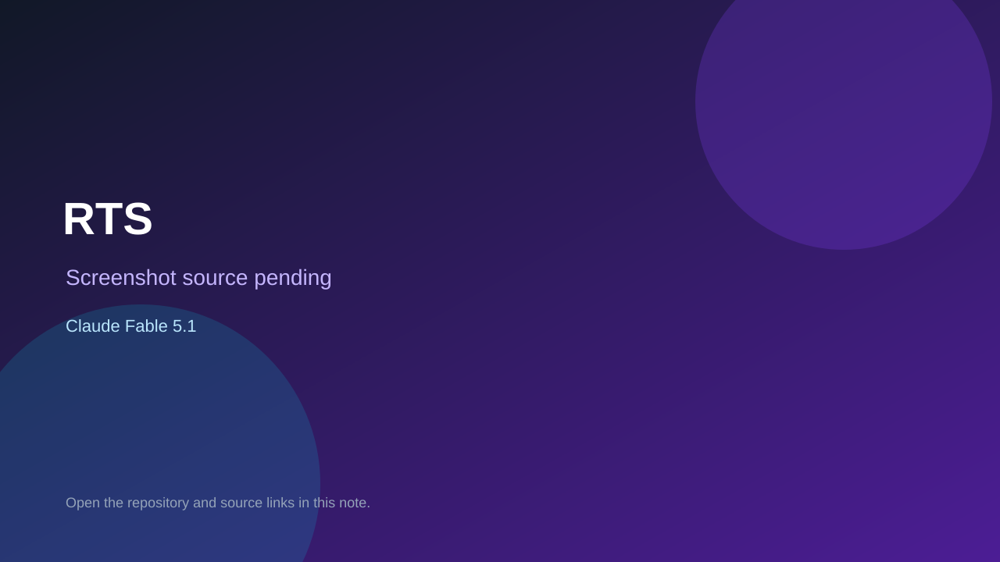

# RTS

> Verified game note.

## At a glance

- **Score:** 7.3/10
- **Model:** Claude Fable 5.1
- **Technology:** C#
- **Estimated FP32 operations/s at 60 FPS:** 1,000,000,000 (low confidence; static estimate, not measured).
- **Rating basis:** Heuristic from source size, README and commit history (5.8 + 0.6*log10(code KB+1), +0.3 with a reachable demo); no runtime playtest.
- **Verified:** 2026-10-27
- **Repository:** [https://github.com/Smoketsu/RTSGame](https://github.com/Smoketsu/RTSGame)
- **Evidence:** [direct model evidence](https://github.com/Smoketsu/RTSGame/commit/4c173724949b8e8c43f397b813709fbe2179a539)

## Screenshots

No screenshot source is recorded yet. Keep the placeholder until a repository, awesome list, or creator source provides an image.

## Model attribution

Open the evidence link above. Evidence grade: **direct model evidence**.

## Source description

A competitive 3D real-time strategy game built in Unity 6. Three asymmetric factions at launch, Skai Riders, water and earth, with fire to follow later. Each player controls one mobile HQ that can be rooted in place and uprooted again. Matches are shaped by… Commit carries an exact Claude Fable 5.1 co-author trailer. Source inspected from README, file tree and commit history only; no playtest.

### Gameplay source

- [https://github.com/Smoketsu/RTSGame/blob/phase-0/foundations/rts/src/Sim/Core/Fix64.cs](https://github.com/Smoketsu/RTSGame/blob/phase-0/foundations/rts/src/Sim/Core/Fix64.cs)
- [https://github.com/Smoketsu/RTSGame/commit/4c173724949b8e8c43f397b813709fbe2179a539](https://github.com/Smoketsu/RTSGame/commit/4c173724949b8e8c43f397b813709fbe2179a539)

## Verification notes

- **Status:** verified_source
- **Counted units in repository:** 1
- **Units covered by this note:** 1
- **Discovery:** GitHub commit pool: model+game commits 2026-10-26T07:00Z..2026-10-27T01:00Z (30-minute Opus 5.5 and 2-6 hour other-model UTC partitions, via gh-read) joined to repositories created after 2026-10-25T01:00Z; https://github.com/Smoketsu/RTSGame

[Back to the awesome list](../../README.md)
