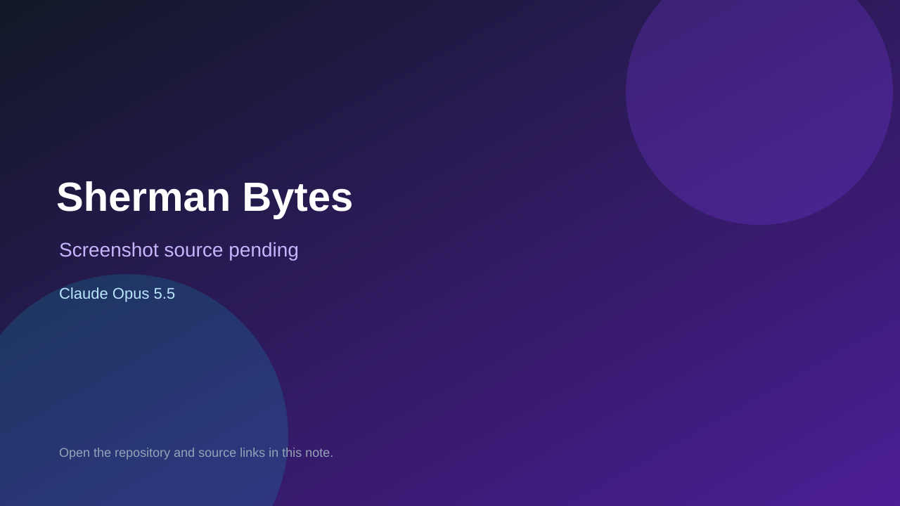

# Sherman Bytes

> Verified game note.

## At a glance

- **Score:** 7.4/10
- **Model:** Claude Opus 5.5
- **Technology:** TypeScript, React, Browser
- **Estimated FP32 operations/s at 60 FPS:** 100,000,000 (low confidence; static estimate, not measured).
- **Rating basis:** Heuristic from source size, README and commit history (5.8 + 0.6*log10(code KB+1), +0.3 with a reachable demo); no runtime playtest.
- **Verified:** 2026-10-26
- **Repository:** [https://github.com/coded-dot-design/sherman-bytes](https://github.com/coded-dot-design/sherman-bytes)
- **Evidence:** [direct model evidence](https://github.com/coded-dot-design/sherman-bytes/commit/5921a3587cbab47a8bc656665e35a562b5c47412)
- **Live demo:** [open demo](https://coded-dot-design.github.io/dom-virus/games/sherman-bytes/)

## Screenshots

No screenshot source is recorded yet. Keep the placeholder until a repository, awesome list, or creator source provides an image.

## Model attribution

Open the evidence link above. Evidence grade: **direct model evidence**.

## Source description

An independent, original, single-player DOM tank game inspired by the terrain, base capture and resupply ideas of Stuart Cheshire’s Bolo. Original pixel art; no Bolo code or assets. Commit carries an exact Claude Opus 5.5 co-author trailer. Live demo returned HTTP 200 (availability only, not a playtest). Source inspected from README, file tree and commit history only; no playtest.

### Gameplay source

- [https://github.com/coded-dot-design/sherman-bytes/blob/main/shared/core.js](https://github.com/coded-dot-design/sherman-bytes/blob/main/shared/core.js)
- [https://github.com/coded-dot-design/sherman-bytes/commit/5921a3587cbab47a8bc656665e35a562b5c47412](https://github.com/coded-dot-design/sherman-bytes/commit/5921a3587cbab47a8bc656665e35a562b5c47412)

## Verification notes

- **Status:** verified_source
- **Counted units in repository:** 1
- **Units covered by this note:** 1
- **Discovery:** GitHub commit pool: model+game commits 2026-10-26T01:00Z..07:00Z (30-minute Opus 5.5 and 2-6 hour other-model UTC partitions, via gh-read) joined to repositories created after 2026-10-24T01:00Z; https://github.com/coded-dot-design/sherman-bytes

[Back to the awesome list](../../README.md)
