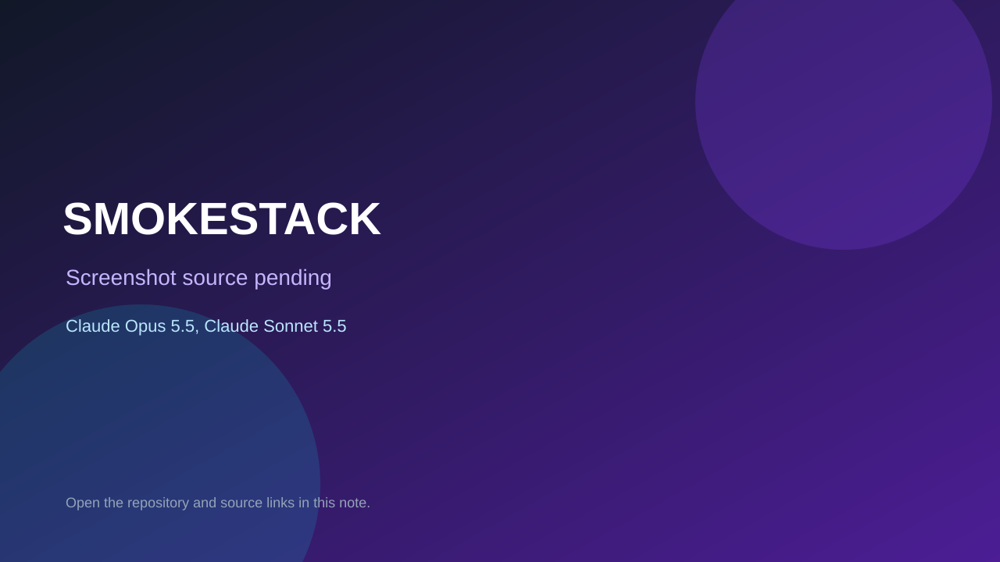

# SMOKESTACK

> Verified game note.

## At a glance

- **Score:** 8.1/10
- **Model:** Claude Opus 5.5, Claude Sonnet 5.5
- **Technology:** TypeScript, Browser
- **Estimated FP32 operations/s at 60 FPS:** 10,000,000 (low confidence; static estimate, not measured).
- **Rating basis:** Heuristic from source size, README and commit history (5.8 + 0.6*log10(code KB+1), +0.3 with a reachable demo); no runtime playtest.
- **Verified:** 2026-10-26
- **Repository:** [https://github.com/pf1991/smokestack](https://github.com/pf1991/smokestack)
- **Evidence:** [direct model evidence](https://github.com/pf1991/smokestack/commit/538a46bcf8225055cf9a83125caf5c37b35136ef)
- **Live demo:** [open demo](https://pf1991.github.io/smokestack/)

## Screenshots

No screenshot source is recorded yet. Keep the placeholder until a repository, awesome list, or creator source provides an image.

## Model attribution

Open the evidence link above. Evidence grade: **direct model evidence**.

## Source description

A 2D industry tycoon for the browser, inspired by Industry Giant. It is 1900. You have $300,000, a map of forests and ore-rich hills, and five small towns that want furniture, bread and, soon, automobiles. Extract raw materials, refine them in factory chains,… Commit carries an exact Claude Opus 5.5 / Claude Sonnet 5.5 co-author trailer. Live demo returned HTTP 200 (availability only, not a playtest). Source inspected from README, file tree and commit history only; no playtest.

### Gameplay source

- [https://github.com/pf1991/smokestack/blob/main/src/render/sprites.ts](https://github.com/pf1991/smokestack/blob/main/src/render/sprites.ts)
- [https://github.com/pf1991/smokestack/commit/538a46bcf8225055cf9a83125caf5c37b35136ef](https://github.com/pf1991/smokestack/commit/538a46bcf8225055cf9a83125caf5c37b35136ef)

## Verification notes

- **Status:** verified_source
- **Counted units in repository:** 1
- **Units covered by this note:** 1
- **Discovery:** GitHub commit pool: model+game commits 2026-10-24T01:00Z..2026-10-26T01:00Z (30-minute Opus 5.5 partitions from 2026-10-24T20:00Z and wider other-model UTC partitions; covers windows left unsearched on 2026-10-25) joined to repositories created after 2026-10-23T01:00Z; https://github.com/pf1991/smokestack

[Back to the awesome list](../../README.md)
