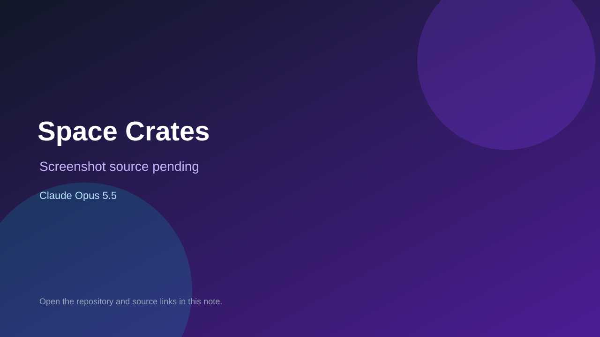

# Space Crates

> Verified game note.

## At a glance

- **Score:** 8.1/10
- **Model:** Claude Opus 5.5
- **Technology:** JavaScript, Browser
- **Estimated FP32 operations/s at 60 FPS:** 10,000,000 (low confidence; static estimate, not measured).
- **Rating basis:** Heuristic from source size, README and commit history (5.8 + 0.6*log10(code KB+1), +0.3 with a reachable demo); no runtime playtest.
- **Verified:** 2026-10-27
- **Repository:** [https://github.com/whomason/space-case](https://github.com/whomason/space-case)
- **Evidence:** [direct model evidence](https://github.com/whomason/space-case/commit/b92462ecc7af99e380a80444194db007523e6b96)
- **Live demo:** [open demo](https://whomason.github.io/space-case/)

## Screenshots

No screenshot source is recorded yet. Keep the placeholder until a repository, awesome list, or creator source provides an image.

## Model attribution

Open the evidence link above. Evidence grade: **direct model evidence**.

## Source description

An 8-bit space crate-opening game: open crates, gear up your astronaut and ship, land on 20 planets, fight aliens, mine ore. Sign in to keep your save in the cloud, add friends, join a crew and trade. Commit carries an exact Claude Opus 5.5 co-author trailer. Live demo returned HTTP 200 (availability only, not a playtest). Source inspected from README, file tree and commit history only; no playtest.

### Gameplay source

- [https://github.com/whomason/space-case/blob/main/index.html](https://github.com/whomason/space-case/blob/main/index.html)
- [https://github.com/whomason/space-case/commit/b92462ecc7af99e380a80444194db007523e6b96](https://github.com/whomason/space-case/commit/b92462ecc7af99e380a80444194db007523e6b96)

## Verification notes

- **Status:** verified_source
- **Counted units in repository:** 1
- **Units covered by this note:** 1
- **Discovery:** GitHub commit pool: model+game commits 2026-10-26T07:00Z..2026-10-27T01:00Z (30-minute Opus 5.5 and 2-6 hour other-model UTC partitions, via gh-read) joined to repositories created after 2026-10-25T01:00Z; https://github.com/whomason/space-case

[Back to the awesome list](../../README.md)
