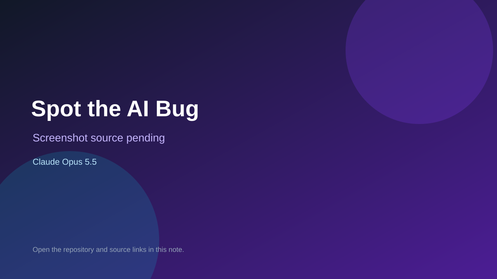

# Spot the AI Bug

> Verified game note.

## At a glance

- **Score:** 7.1/10
- **Model:** Claude Opus 5.5
- **Technology:** TypeScript, Browser
- **Estimated FP32 operations/s at 60 FPS:** 10,000,000 (low confidence; static estimate, not measured).
- **Rating basis:** Heuristic from source size, README and commit history (5.8 + 0.6*log10(code KB+1), +0.3 with a reachable demo); no runtime playtest.
- **Verified:** 2026-10-26
- **Repository:** [https://github.com/satyamdhamne/ai_dev_game](https://github.com/satyamdhamne/ai_dev_game)
- **Evidence:** [direct model evidence](https://github.com/satyamdhamne/ai_dev_game/commit/d1647e31a12c7fe3c61b9698c2c8bc514d3edd9f)

## Screenshots

No screenshot source is recorded yet. Keep the placeholder until a repository, awesome list, or creator source provides an image.

## Model attribution

Open the evidence link above. Evidence grade: **direct model evidence**.

## Source description

A daily, Wordle-style game for developers. Every day, every player gets the same short "PR written by AI" containing exactly one real bug. Tap the buggy line (3 attempts, with 🔥 warm / ❄️ cold hints), then name the bug type for bonus points, and share your… Commit carries an exact Claude Opus 5.5 co-author trailer. Source inspected from README, file tree and commit history only; no playtest.

### Gameplay source

- [https://github.com/satyamdhamne/ai_dev_game/blob/ccr-5d417cca-tqhjk9/lib/interview.ts](https://github.com/satyamdhamne/ai_dev_game/blob/ccr-5d417cca-tqhjk9/lib/interview.ts)
- [https://github.com/satyamdhamne/ai_dev_game/commit/d1647e31a12c7fe3c61b9698c2c8bc514d3edd9f](https://github.com/satyamdhamne/ai_dev_game/commit/d1647e31a12c7fe3c61b9698c2c8bc514d3edd9f)

## Verification notes

- **Status:** verified_source
- **Counted units in repository:** 1
- **Units covered by this note:** 1
- **Discovery:** GitHub commit pool: model+game commits 2026-10-24T01:00Z..2026-10-26T01:00Z (30-minute Opus 5.5 partitions from 2026-10-24T20:00Z and wider other-model UTC partitions; covers windows left unsearched on 2026-10-25) joined to repositories created after 2026-10-23T01:00Z; https://github.com/satyamdhamne/ai_dev_game

[Back to the awesome list](../../README.md)
