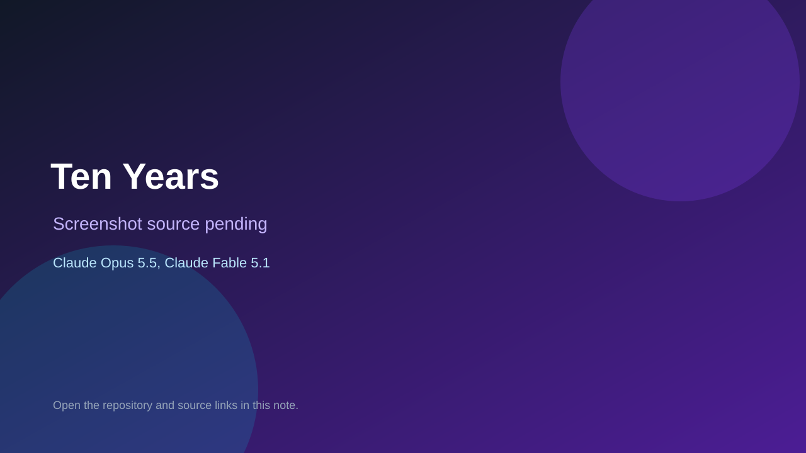

# Ten Years

> Verified game note.

## At a glance

- **Score:** 7.7/10
- **Model:** Claude Opus 5.5, Claude Fable 5.1
- **Technology:** JavaScript, Browser
- **Estimated FP32 operations/s at 60 FPS:** 1,000,000,000 (low confidence; static estimate, not measured).
- **Rating basis:** Heuristic from source size, README and commit history (5.8 + 0.6*log10(code KB+1), +0.3 with a reachable demo); no runtime playtest.
- **Verified:** 2026-10-25
- **Repository:** [https://github.com/fightingorange/life-in-gulag](https://github.com/fightingorange/life-in-gulag)
- **Evidence:** [direct model evidence](https://github.com/fightingorange/life-in-gulag/commit/2e15a2f49a204abaed4847fa69e4d920d1ce86a5)
- **Live demo:** [open demo](https://fightingorange.github.io/life-in-gulag/)

## Screenshots

No screenshot source is recorded yet. Keep the placeholder until a repository, awesome list, or creator source provides an image.

## Model attribution

Open the evidence link above. Evidence grade: **direct model evidence**.

## Source description

A text game about one winter in a Soviet labour camp, 1951. Ten years is too long to hold in your head, so the old prisoners say: count the winter. Survive until the ice goes out on the river on 20 May, or go through the wire and down the river on the ice. Commit carries an exact Claude Opus 5.5 / Claude Fable 5.1 co-author trailer. Live demo returned HTTP 200 (availability only, not a playtest). Source inspected from README, file tree and commit history only; no playtest.

### Gameplay source

- [https://github.com/fightingorange/life-in-gulag/blob/main/js/fx.js](https://github.com/fightingorange/life-in-gulag/blob/main/js/fx.js)
- [https://github.com/fightingorange/life-in-gulag/commit/2e15a2f49a204abaed4847fa69e4d920d1ce86a5](https://github.com/fightingorange/life-in-gulag/commit/2e15a2f49a204abaed4847fa69e4d920d1ce86a5)

## Verification notes

- **Status:** verified_source
- **Counted units in repository:** 1
- **Units covered by this note:** 1
- **Discovery:** GitHub commit pool: model+game commits 2026-10-23T01:00Z..2026-10-24T01:00Z (30-minute Opus 5.5 and wider other-model UTC partitions) joined to repositories created after 2026-10-22T01:00Z; carried over from the 2026-10-24 pending list; https://github.com/fightingorange/life-in-gulag

[Back to the awesome list](../../README.md)
