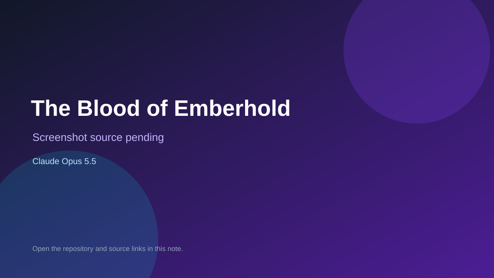

# The Blood of Emberhold

> Verified game note.

## At a glance

- **Score:** 7.6/10
- **Model:** Claude Opus 5.5
- **Technology:** TypeScript, Three.js, React, Browser
- **Estimated FP32 operations/s at 60 FPS:** 1,000,000,000 (low confidence; static estimate, not measured).
- **Rating basis:** Heuristic from source size, README and commit history (5.8 + 0.6*log10(code KB+1), +0.3 with a reachable demo); no runtime playtest.
- **Verified:** 2026-10-27
- **Repository:** [https://github.com/yuvasaivarmaj/emberhold-game](https://github.com/yuvasaivarmaj/emberhold-game)
- **Evidence:** [direct model evidence](https://github.com/yuvasaivarmaj/emberhold-game/commit/5efbf376cf4c15d5c4bc7ab9ec5211abf12ee946)
- **Live demo:** [open demo](https://yuvasaivarmaj.github.io/emberhold-game/)

## Screenshots

No screenshot source is recorded yet. Keep the placeholder until a repository, awesome list, or creator source provides an image.

## Model attribution

Open the evidence link above. Evidence grade: **direct model evidence**.

## Source description

A first-person, open-world browser game based on The Blood of Emberhold, Part One: What the Blood Remembers. Commit carries an exact Claude Opus 5.5 co-author trailer. Live demo returned HTTP 200 (availability only, not a playtest). Source inspected from README, file tree and commit history only; no playtest.

### Gameplay source

- [https://github.com/yuvasaivarmaj/emberhold-game/blob/main/src/world/Emberhold.ts](https://github.com/yuvasaivarmaj/emberhold-game/blob/main/src/world/Emberhold.ts)
- [https://github.com/yuvasaivarmaj/emberhold-game/commit/5efbf376cf4c15d5c4bc7ab9ec5211abf12ee946](https://github.com/yuvasaivarmaj/emberhold-game/commit/5efbf376cf4c15d5c4bc7ab9ec5211abf12ee946)

## Verification notes

- **Status:** verified_source
- **Counted units in repository:** 1
- **Units covered by this note:** 1
- **Discovery:** GitHub commit pool: model+game commits 2026-10-26T07:00Z..2026-10-27T01:00Z (30-minute Opus 5.5 and 2-6 hour other-model UTC partitions, via gh-read) joined to repositories created after 2026-10-25T01:00Z; https://github.com/yuvasaivarmaj/emberhold-game

[Back to the awesome list](../../README.md)
