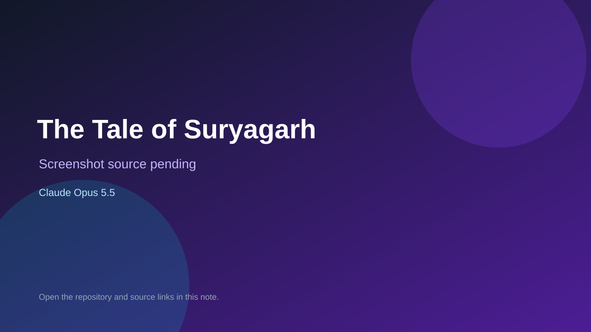

# The Tale of Suryagarh

> Verified game note.

## At a glance

- **Score:** 7.4/10
- **Model:** Claude Opus 5.5
- **Technology:** Python
- **Estimated FP32 operations/s at 60 FPS:** 1,000,000 (low confidence; static estimate, not measured).
- **Rating basis:** Heuristic from source size, README and commit history (5.8 + 0.6*log10(code KB+1), +0.3 with a reachable demo); no runtime playtest.
- **Verified:** 2026-10-25
- **Repository:** [https://github.com/Mrigank-Kumar-Paul-NGL/The-Tale-of-Suryagarh](https://github.com/Mrigank-Kumar-Paul-NGL/The-Tale-of-Suryagarh)
- **Evidence:** [direct model evidence](https://github.com/Mrigank-Kumar-Paul-NGL/The-Tale-of-Suryagarh/commit/6844a8caa12e1a61179ba6b0cbe7c1758d9880f7)
- **Live demo:** [open demo](https://tale-of-suryagarh.vercel.app)

## Screenshots

No screenshot source is recorded yet. Keep the placeholder until a repository, awesome list, or creator source provides an image.

## Model attribution

Open the evidence link above. Evidence grade: **direct model evidence**.

## Source description

Dark-fantasy text RPG set in a city that forgot the sun, with an AI dungeon master. Forge a hero, fight with tells, dodges and parries, earn Swarna Heer armour, and face the dragon Agnivara. Play free in your browser. Commit carries an exact Claude Opus 5.5 co-author trailer. Live demo returned HTTP 200 (availability only, not a playtest). Source inspected from README, file tree and commit history only; no playtest.

### Gameplay source

- [https://github.com/Mrigank-Kumar-Paul-NGL/The-Tale-of-Suryagarh/blob/main/backend/combat.py](https://github.com/Mrigank-Kumar-Paul-NGL/The-Tale-of-Suryagarh/blob/main/backend/combat.py)
- [https://github.com/Mrigank-Kumar-Paul-NGL/The-Tale-of-Suryagarh/commit/6844a8caa12e1a61179ba6b0cbe7c1758d9880f7](https://github.com/Mrigank-Kumar-Paul-NGL/The-Tale-of-Suryagarh/commit/6844a8caa12e1a61179ba6b0cbe7c1758d9880f7)

## Verification notes

- **Status:** verified_source
- **Counted units in repository:** 1
- **Units covered by this note:** 1
- **Discovery:** GitHub commit pool: model+game commits 2026-10-24T01:00Z..2026-10-25T01:00Z (30-minute Opus 5.5 and wider other-model UTC partitions) joined to repositories created after 2026-10-23T01:00Z; https://github.com/Mrigank-Kumar-Paul-NGL/The-Tale-of-Suryagarh

[Back to the awesome list](../../README.md)
