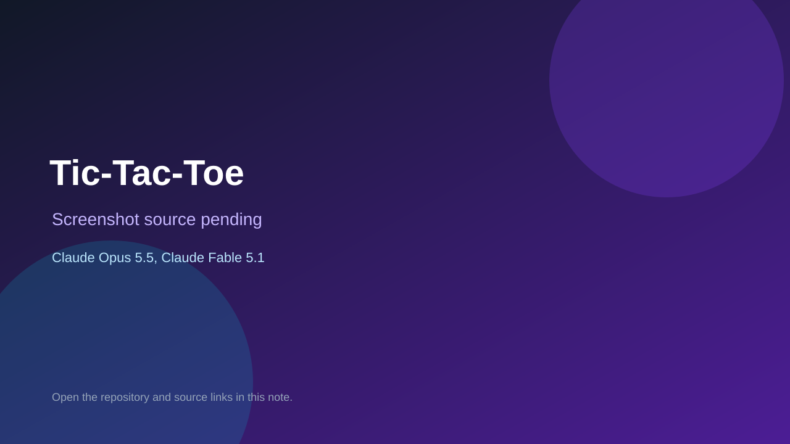

# Tic-Tac-Toe

> Verified game note.

## At a glance

- **Score:** 6.3/10
- **Model:** Claude Opus 5.5, Claude Fable 5.1
- **Technology:** JavaScript, Browser
- **Estimated FP32 operations/s at 60 FPS:** 10,000,000 (low confidence; static estimate, not measured).
- **Rating basis:** Heuristic from source size, README and commit history (5.8 + 0.6*log10(code KB+1), +0.3 with a reachable demo); no runtime playtest.
- **Verified:** 2026-10-25
- **Repository:** [https://github.com/wpm/tic-tac-toe](https://github.com/wpm/tic-tac-toe)
- **Evidence:** [direct model evidence](https://github.com/wpm/tic-tac-toe/commit/2488bcc5c5487f13ef2d66dbad1bf9508a116b56)

## Screenshots

No screenshot source is recorded yet. Keep the placeholder until a repository, awesome list, or creator source provides an image.

## Model attribution

Open the evidence link above. Evidence grade: **direct model evidence**.

## Source description

A browser tic-tac-toe game in plain JavaScript: you play X against a computer O that uses minimax, so it never loses. Run npm install once, npm test to run the tests, and npm start to serve the page locally. Commit carries an exact Claude Opus 5.5 / Claude Fable 5.1 co-author trailer. Source inspected from README, file tree and commit history only; no playtest.

### Gameplay source

- [https://github.com/wpm/tic-tac-toe/blob/main/src/minimax.js](https://github.com/wpm/tic-tac-toe/blob/main/src/minimax.js)
- [https://github.com/wpm/tic-tac-toe/commit/2488bcc5c5487f13ef2d66dbad1bf9508a116b56](https://github.com/wpm/tic-tac-toe/commit/2488bcc5c5487f13ef2d66dbad1bf9508a116b56)

## Verification notes

- **Status:** verified_source
- **Counted units in repository:** 1
- **Units covered by this note:** 1
- **Discovery:** GitHub commit pool: model+game commits 2026-10-23T01:00Z..2026-10-24T01:00Z (30-minute Opus 5.5 and wider other-model UTC partitions) joined to repositories created after 2026-10-22T01:00Z; carried over from the 2026-10-24 pending list; https://github.com/wpm/tic-tac-toe

[Back to the awesome list](../../README.md)
