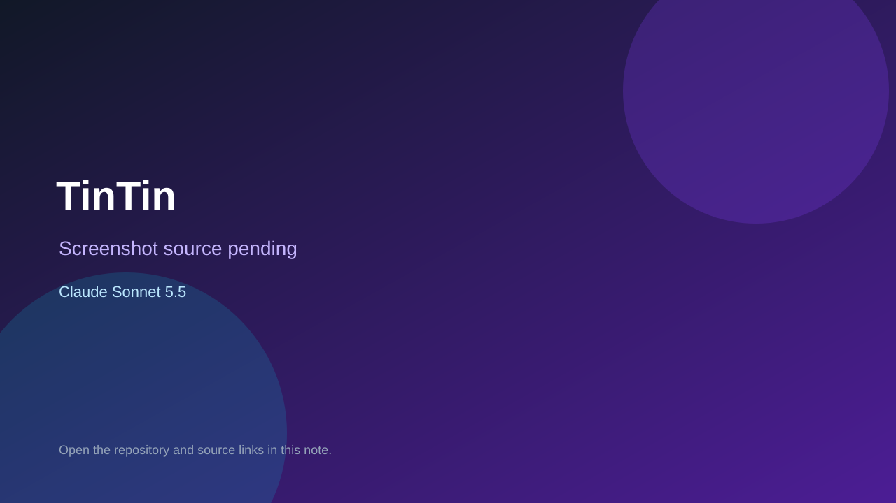

# TinTin

> Verified game note.

## At a glance

- **Score:** 7.9/10
- **Model:** Claude Sonnet 5.5
- **Technology:** TypeScript, Three.js, React
- **Estimated FP32 operations/s at 60 FPS:** 1,000,000,000 (low confidence; static estimate, not measured).
- **Rating basis:** Heuristic from source size, README and commit history (5.8 + 0.6*log10(code KB+1), +0.3 with a reachable demo); no runtime playtest.
- **Verified:** 2026-10-27
- **Repository:** [https://github.com/tonmoydeb404/tintin](https://github.com/tonmoydeb404/tintin)
- **Evidence:** [direct model evidence](https://github.com/tonmoydeb404/tintin/commit/1e82615017275d4c57ccc34e1d4d5dbe4af2f6c7)
- **Live demo:** [open demo](https://pad-games.vercel.app)

## Screenshots

No screenshot source is recorded yet. Keep the placeholder until a repository, awesome list, or creator source provides an image.

## Model attribution

Open the evidence link above. Evidence grade: **direct model evidence**.

## Source description

An open-world jungle survival sandbox (in progress — see ROADMAP.md) that runs in the browser and is fully. Commit carries an exact Claude Sonnet 5.5 co-author trailer. Live demo returned HTTP 200 (availability only, not a playtest). Source inspected from README, file tree and commit history only; no playtest.

### Gameplay source

- [https://github.com/tonmoydeb404/tintin/blob/main/.agents/skills/godot-nodes-scenes/scripts/check_godot_project.py](https://github.com/tonmoydeb404/tintin/blob/main/.agents/skills/godot-nodes-scenes/scripts/check_godot_project.py)
- [https://github.com/tonmoydeb404/tintin/commit/1e82615017275d4c57ccc34e1d4d5dbe4af2f6c7](https://github.com/tonmoydeb404/tintin/commit/1e82615017275d4c57ccc34e1d4d5dbe4af2f6c7)

## Verification notes

- **Status:** verified_source
- **Counted units in repository:** 1
- **Units covered by this note:** 1
- **Discovery:** GitHub commit pool: model+game commits 2026-10-26T07:00Z..2026-10-27T01:00Z (30-minute Opus 5.5 and 2-6 hour other-model UTC partitions, via gh-read) joined to repositories created after 2026-10-25T01:00Z; https://github.com/tonmoydeb404/tintin

[Back to the awesome list](../../README.md)
